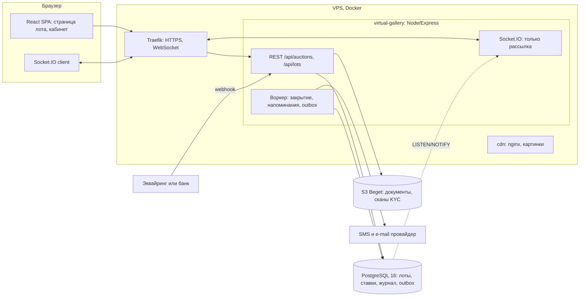
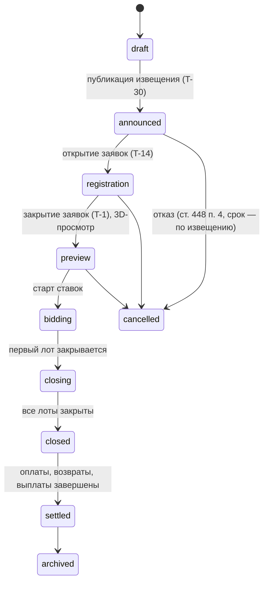
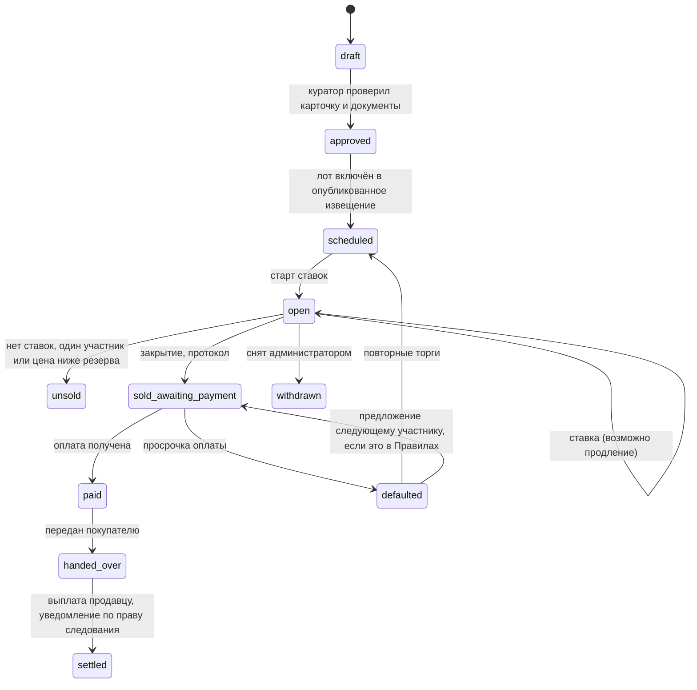

# Аукцион virtgal.ru: проект инфраструктуры, правового пакета и финансов

Дата: 2026-10-17. Ветка `docs/auction-research`. Код и `docs/AUCTION-RESEARCH.md` не менялись, ничего не закоммичено и не отправлено (файл новый, не в индексе).
Документ продолжает первый отчёт ([AUCTION-RESEARCH.md](AUCTION-RESEARCH.md)): здесь нормы права и правила площадок сверены с первоисточниками, а на этой основе описан проект аукциона.

**Как читать пометки**

| Пометка | Значение |
|---|---|
| `[П-n]` | Подтверждено прочтением страницы-первоисточника; `n` — номер в разделе 10, там же адрес и дата чтения (все страницы читались 17.10.2026). Цитаты короткие, в кавычках |
| `[Н]` | Не подтверждено: источник не открылся или не прочитан |
| `[Ю]` | Юридический вывод или выбор, проверить с юристом |
| `[О]` | Мнение или рекомендация автора отчёта, источника нет |
| `[Пр]` | Условный пример: цифры придуманы для иллюстрации и не являются рекомендацией или данными рынка |
| `[К]` | Факт из кода репозитория, проверен чтением файла |

Нормы читались на consultant.ru в редакциях, которые сайт показывал 17.10.2026 (например, ГК РФ ч. 1 — «ред. от 10.06.2026», 63-ФЗ — «ред. от 31.07.2025», 152-ФЗ — «ред. от 26.07.2026»). Это не официальный публикатор: полнота базы КонсультантПлюс не проверялась `[Н]`, `pravo.gov.ru` закрыт.

---

## 1. Резюме и ключевые решения

**Суть.** Ст. 447 п. 4 ГК называет торги (в том числе электронные) формой аукциона, а выигравшим — лицо, «предложившее наиболее высокую цену» `[П-1]`. По моему прочтению аукцион на сайте с публичным извещением, ставками и задатком подпадает под ст. 447–449 `[О][Ю]`, и тогда из норм следуют календарь и набор документов: извещение не позднее чем за 30 дней, задаток по условиям извещения, возврат задатка проигравшим, протокол в день торгов, возможность оспорить торги в течение года. Вся механика ниже построена так, чтобы укладываться в эти нормы дёшево: анонс за 30 дней, регистрация и 3D-просмотр в последние 14 дней, затем 14 суток ставок. `[Ю]` — правильность квалификации и сокращения сроков юрист должен подтвердить до запуска.

**Рынок.** Онлайн-аукционы крупных площадок идут по нескольку суток: Christie's — «usually 14 to 21 days» `[П-14]`, на Artsy из 58 просмотренных онлайн-торгов медиана 14 суток, 30 из 58 — ровно 14 `[П-16]`. Конец лота продлевается при ставке в последние минуты (Christie's: ставка за 3 минуты до конца — ещё 3 минуты; Sotheby's: ставка за 1 минуту — продление до 2 минут от последней ставки, но не более 2 часов `[П-14][П-15]`). Участник задаёт максимальную ставку, система повышает цену за него шагами, при равных максимумах побеждает более ранний. Ставка необратима. Покупатель платит молоток плюс комиссию покупателя; на онлайн-торгах оплата сразу (Christie's) или в течение 7 дней (Artsy).

**Техника.** Хватает существующего стека: Express + PostgreSQL. Ставка — одна транзакция с блокировкой строки лота; Socket.IO только рассылает события (ставки идут по HTTP); закрытие лотов — воркер раз в секунду; уведомления — через таблицу-очередь; журнал ставок неизменяем, с цепочкой хешей. Алгоритм ставки с max-ставками, продлением, резервом и закрытием написан на PL/pgSQL и проверен на локальном PostgreSQL 16.15 (10 сценариев и 8 параллельных сессий по 60 попыток; приложение А).

**Деньги.** Для первых аукционов достаточно ручного задатка по реквизитам, онлайн-приём платежей и возвраты — второй этап. Холд карты не годится как основа: окно подтверждения платежа зависит от способа оплаты и ограничено (механика подтверждена документацией SDK ЮKassa, сами сроки — нет `[П-20][Н]`).

**Что блокирует запуск:** решение о юрлице-организаторе и его налоговом режиме, консультация юриста по пакету из раздела 5, выбор SMS/e-mail-провайдера и платёжного провайдера (их сайты закрыты, раздел 9), закрытие P0-дефектов текущего кода из первого отчёта.

### Ключевые решения

| № | Решение | Вариант A (рекомендуется) | Вариант B | Кто решает |
|---|---|---|---|---|
| 1 | Структура организатора | Юрлицо или ИП как организатор торгов и **комиссионер** (от своего имени, за счёт продавца; ст. 447 п. 2, 990 ГК `[П-1][П-2]`) | Площадка для партнёрских аукционных домов («только место»), как Invaluable и LiveAuctioneers `[П-17]`; либо собственник работ (выкуп) | Владелец, юрист `[Ю]` |
| 2 | Режим | Торги по ст. 447–449 ГК: анонс не позднее чем за 30 дней, протокол в день торгов, задаток по извещению | «Продажа по публичной оферте» без квалификации «торги»: проще сроки, выше риск переквалификации | Юрист `[Ю]` |
| 3 | Календарь | Анонс T−30, заявки и 3D-просмотр T−14, 14 суток ставок, лоты закрываются вечером с шагом в 1 минуту | 7–10 суток (динамичнее, но дальше от рынка) | Владелец, аукционист |
| 4 | Ставки | Шкала шага (раздел 4.3), max-ставки, равные максимумы — побеждает более ранний, ставки необратимы, ставок «от имени продавца» нет | Ограниченная отмена ставки как на Invaluable (3 за сессию, не за 2 часа до конца) `[П-17]` | Владелец |
| 5 | Резерв | **Публичная минимальная цена** (= стартовая): честно относительно ст. 448 п. 2 и ст. 449 п. 1 | Скрытый резерв с объявленным фактом его наличия (рыночная практика) | Юрист `[Ю]`, владелец |
| 6 | Допуск | Заявка → ручная проверка личности → подписание документов простой ЭП (SMS/e-mail-код) → обеспечение → лимит ставок | Вход через Госуслуги, подпись УКЭП для лотов дороже порога `[Н]` | Владелец |
| 7 | Обеспечение | Этап 1: ручной задаток по реквизитам, фиксированная сумма на аукцион, лимит ставок = сумма × множитель `[Пр]` 10 | Этап 2: онлайн-платёж с автоматическим возвратом; холд — только как дополнение | Владелец, бухгалтер |
| 8 | Оплата и неоплата | Счёт сразу после закрытия, срок `[Пр]` 5 рабочих дней, при просрочке задаток удерживается, лот переторговывается или предлагается следующему | Для лотов дороже порога — эскроу (ст. 860.7 ГК) или аккредитив (ст. 867) `[П-2]` | Юрист `[Ю]` |
| 9 | Техника | Монолит + PostgreSQL с блокировкой лота, Socket.IO только на отправку, outbox, журнал с цепочкой хешей, без Redis | Отдельный контейнер-воркер, Redis-адаптер при втором экземпляре | Разработка |
| 10 | Налоги и право следования | Сборы организатора — вознаграждение комиссионера (ст. 156 НК), отчисления автору по шкале ПП № 285 с уведомлением в 10 рабочих дней | Организатор берёт обязанность выплаты на себя по соглашению с продавцом (п. 10 Правил) `[П-4]` | Бухгалтер, юрист |

Дополнительно, из ст. 447 п. 5 ГК: **«аукцион, в котором участвовал только один участник, признаётся несостоявшимся»** `[П-1]`. Для тонкого рынка это означает: лот с одним участником — не продажа по торгам; нужна оговорка в Правилах (раздел 5.1) и «послеаукционная продажа» по предложению единственного участника. `[Ю]`

---

## 2. Что подтвердилось и что нет в первом отчёте

Статусы: **подтверждено** — текст первоисточника совпадает; **уточнено** — верно, но с оговоркой, которой не было; **не подтверждено текстом** — первоисточник не содержит этого; **не проверено** — сайт закрыт. Прямо опровергнутых утверждений о нормах не обнаружено; ниже всё, что изменилось или осталось без подтверждения.

| Утверждение первого отчёта | Статус | Источник и что именно в тексте |
|---|---|---|
| Извещение о торгах — не позднее чем за 30 дней | Подтверждено, уточнено | Ст. 448 п. 2: «Если иное не предусмотрено законом, извещение … должно быть опубликовано организатором не позднее чем за тридцать дней до их проведения»; в нём — время, место, форма, предмет, обременения, порядок проведения, оформление участия, определение победителя, начальная цена `[П-1]`. «Иное» — по тексту — устанавливает закон, а не договор или Правила `[Ю]` |
| Организатор вправе отказаться от аукциона не позднее чем за 3 дня | Подтверждено, уточнено | Ст. 448 п. 4: «Если иное не предусмотрено в законе или в извещении…»; при нарушении срока — возмещение «реального ущерба» участникам `[П-1]`. То есть срок можно изменить в извещении |
| Протокол подписывают в день аукциона, он «имеет силу договора», уклонившийся возмещает убытки сверх обеспечения | Подтверждено, уточнено | Ст. 448 п. 6, с оговоркой «Если иное не установлено законом» `[П-1]`. Для онлайн-торгов нужна заранее выраженная воля (раздел 4.4) |
| Задаток: размер, сроки, порядок — в извещении; у победителя засчитывается; проигравшим возвращается | Подтверждено, дополнено | Ст. 448 п. 5: возврат при несостоявшихся торгах и тем, «кто не выиграл»; исполнение можно обеспечить независимой гарантией `[П-1]`. Первый отчёт не знал про ст. 381.1 (обеспечительный платёж) `[П-1]` |
| Ст. 380 п. 1–3 и ст. 381 (задаток) | Подтверждено | Ст. 380: п. 2 «Соглашение о задатке независимо от суммы … в письменной форме»; п. 3 при сомнении сумма — аванс; ст. 381 п. 2: у виновного задаток остаётся, убытки возмещаются «с зачетом суммы задатка» `[П-1]` |
| Ст. 449.1 — публичные торги, к проекту не относится | Подтверждено (снят `[Н]`) | П. 1: торги «в целях исполнения решения суда или исполнительных документов в порядке исполнительного производства» `[П-1]` |
| «Открытый/закрытый» аукцион — круг участников, а не видимость ставок | Подтверждено (снят `[Н]`) | Ст. 448 п. 1: в открытом «может участвовать любое лицо», в закрытом — «специально приглашенные» `[П-1]` |
| Победитель аукциона — предложивший наиболее высокую цену | Подтверждено | Ст. 447 п. 4 `[П-1]` |
| (новое) Торги с одним участником не состоялись | Новое | Ст. 447 п. 5 `[П-1]` |
| (новое) Торги можно оспорить в течение года | Новое | Ст. 449 п. 1: основания — необоснованное отстранение, «неосновательно не принята высшая предложенная цена», продажа раньше срока, иные существенные нарушения `[П-1]` |
| Право следования: ст. 1293, платит продавец, при участии юрлица или ИП | Подтверждено | Ст. 1293 п. 1: «от продавца вознаграждения в виде процентных отчислений от цены перепродажи»; ПП № 285 п. 3: «Плательщиками … являются продавцы» `[П-3][П-4]` |
| ПП № 285 от 19.04.2008 «в редакции 2018 г.» | Подтверждено | На consultant.ru последняя редакция — от 28.08.2018 (ПП № 1020); более поздних редакций в базе не показано `[П-4][Н]` по полноте базы |
| Шкала: «5 % до 100 тыс. ₽» и «305,5 тыс. + 0,25 % свыше 17 500 тыс.» | Подтверждено, ограничение «использовать нельзя» снято | Полная шкала из приложения к ПП № 285 — в разделе 4.6 и таблице расчёта в разделе 6; крайние ступени совпадают с аннотацией Гаранта `[П-4][П-5]`. Остаётся вопрос, что считать «ценой перепродажи» (молоток или молоток с комиссией): текст не определяет `[Ю]` |
| Поправки к ст. 1293 вступили в силу 01.06.2018 | Не подтверждено текстом | В статье: «п. 1 в ред. Федерального закона от 05.12.2017 N 381-ФЗ», дата вступления в силу в тексте не указана `[П-3]` |
| Организацию по управлению правом следования зовут УПРАВИС | Не подтверждено | ПП № 285 говорит об «аккредитованной организации» без названия `[П-4]`; `upravis.ru` закрыт |
| (новое) Обязанность уведомить о перепродаже | Новое | ПП № 285 п. 6(1): посредник (или продавец/покупатель в случаях п. 6) в срок «не превышающий 10 рабочих дней со дня совершения сделки» направляет уведомление: название произведения, сведения об авторе, фотокопия `[П-4]` |
| 152-ФЗ: локализация (ч. 5 ст. 18) | Подтверждено, цифры штрафа теперь первичные | Ст. 18 ч. 5: запись, хранение и пр. ПД граждан РФ «с использованием баз данных, находящихся за пределами территории Российской Федерации, не допускаются» (с исключениями); КоАП ст. 13.11 ч. 8: юрлицам от 1 до 6 млн ₽ `[П-7][П-8]` |
| Уведомление Роскомнадзора об обработке ПД | Подтверждено | Ст. 22 ч. 1: оператор обязан уведомить «до начала обработки»; исключения в ч. 2 (обработка без средств автоматизации и др.) нас не покрывают; КоАП 13.11 ч. 10: юрлицам 100–300 тыс. ₽ `[П-7][П-8]` |
| «Отдельное согласие на обработку ПД с 01.09.2025» | Частично | Ст. 9 ч. 1: согласие «должно быть оформлено отдельно от иных информации и (или) документов» (в ред. 156-ФЗ от 24.06.2025) `[П-7]`; дата 01.09.2025 текстом статьи не подтверждена `[Н]` |
| Маркировка рекламы (ст. 18.1 38-ФЗ) | Подтверждено, уточнено | Ч. 16: реклама в интернете должна содержать «пометку "реклама"» и указание на рекламодателя; ч. 17: распространение допускается при условии присвоения оператором рекламных данных «идентификатора рекламы». Слова «erid» в тексте закона нет `[П-10]` |
| Запрет рекламы на ресурсах Meta с 1 сентября 2025 | Уточнено | Ст. 5 ч. 10.7 (введена 72-ФЗ от 07.04.2025): запрещена реклама на ресурсах организаций, деятельность которых признана нежелательной или запрещена судом, «а также на других информационных ресурсах, доступ к которым ограничен». Meta закон не называет, даты 01.09.2025 в тексте нет `[П-10]`. Позиция ФАС по Telegram — `fas.gov.ru` закрыт `[Н]` |
| Реклама по рассылкам — только с согласия | Подтверждено (раньше `[Н]`) | Ст. 18 ч. 1: «только при условии предварительного согласия»; бремя доказательства на рекламораспространителе; ч. 2 запрещает «автоматическую рассылку» без участия человека `[П-10]`. Как это соотносится с автоматическими SMS-рассылками — `[Ю]` |
| 115-ФЗ: относятся ли аукционные дома и галереи к субъектам | Ответ: **в тексте не нашёл** | Ст. 5 (перечень организаций) и ст. 7.1 (иные лица) прочитаны: галерей, аукционных домов, торговцев произведениями искусства нет. В перечне есть «операторы по приему платежей» и торговцы изделиями из драгметаллов и камней `[П-11]`. Разъяснения Росфинмониторинга (`fedsfm.ru`) закрыты `[Н]`. Практика Christie's — проверять личность «to comply with anti-money laundering and sanctions laws» — это корпоративное правило, не наша норма `[П-14]` |
| НДС и НДФЛ: «поиск не дал ответа» | Теперь частично закрыто | НДС: ставка 22 % (ст. 164 п. 3); база комиссионера — вознаграждение (ст. 156 п. 1); освобождений для аукционных услуг в пп. 20 п. 2 ст. 149 (организации культуры и искусства) не нашёл. НДФЛ физлица-продавца: освобождение при владении три года и более (ст. 217 п. 17.1), иначе вычет до 250 тыс. ₽ в год (ст. 220 п. 1 пп. 1) `[П-12]`. Роль комиссионера как налогового агента по НДФЛ — `[Н]` |
| Чеки 54-ФЗ при приёме задатка | Не подтверждено текстом | Расчёты — «прием (получение) и выплата денежных средств … за товары, работы, услуги» (ст. 1.1); для интернет-платежей чек направляется на номер или e-mail, указанные до расчёта (ст. 1.2 п. 5); слова «задаток» в тексте закона нет; «признак способа расчёта» — не в законе `[П-9]`. Квалификация задатка — `[Ю]` бухгалтеру |
| Защита прав потребителей и возврат (первый отчёт: «вопрос отдельный») | Новое и важное | Ст. 26.1 п. 4: потребитель вправе отказаться от товара «до его передачи, а после передачи — в течение семи дней» при дистанционной продаже; исключение — товар с индивидуально-определёнными свойствами, если он «может быть использован исключительно приобретающим его потребителем» `[П-13]`. Применимость к торгам — `[Ю]`, часть п. 3–4 признана не соответствующей Конституции постановлением КС РФ 7-П от 17.02.2026, его текст не читался `[Н]` |
| Холд: ЮKassa «от 2 часов до 7 дней», CloudPayments «до 7 дней» | Не проверено | `yookassa.ru`, `cloudpayments.ru` закрыты. Подтверждена только механика: платёж в `waiting_for_capture` подтверждается «только в течение определенного времени (зависит от способа оплаты)», иначе автоматически отменяется и деньги возвращаются `[П-20]` |
| SEO: Google не рекомендует dynamic rendering; Яндекс советует отключать JS-рендеринг при SSR | Подтверждено | Google: «Dynamic rendering was a workaround and not a long-term solution»; рекомендует server-side rendering; Яндекс: «Запретите рендеринг, если на сайте реализован SSR … или пререндеринг» `[П-19]` |
| Socket.IO в проде не запущен | Подтверждено на ветке | `server.js` не содержит `socket.io`; в `docker-compose.prod.yml` комментарий «virtgal.ru → приложение (API, SPA, Socket.IO)» `[К]` |
| Рыночные цифры (4,1 млрд ₽ и др.), комиссии российских домов, Traefik WebSocket | Не проверено | Домены закрыты (раздел 9) |

---

## 3. Как устроены онлайн-торги у реальных площадок

Читались открытые страницы (адреса и даты — раздел 10). Российские аукционные дома найти в открытом доступе не удалось (раздел 3.6).

### 3.1. Christie's (online-only и LIVE) `[П-14]`

- **Допуск.** Нужен аккаунт с подтверждённой личностью: паспорт или другой документ с фото и подтверждение адреса не старше трёх месяцев; для организаций — учредительные документы, директора, бенефициары, доверенности. Цель названа прямо: соблюдение законов о противодействии отмыванию денег и санкциях и защита от мошенничества. «You may also be asked for a financial reference and/or a deposit as a condition of allowing you to bid» (депозит только по запросу).
- **Регистрация на торги.** Онлайн: кнопка Register на странице аукциона, можно «before the auction, or any time during». Подтверждается адрес доставки.
- **Длительность.** Онлайн-аукционы без зала — «usually 14 to 21 days»; в 2025 г. 81 % ставок сделано онлайн (данные самой площадки).
- **Продление.** «If a bid is placed within three minutes of the closing time of a lot, the lot will remain open for three additional minutes, until no further bids have been placed». Совет синхронизировать часы устройства.
- **Шаг.** Для онлайн-торгов шаги заданы «в Conditions of Sale на странице аукциона» (самой таблицы не получено). Таблица для зала: $100–2 000 шаг $100; 2 000–3 000 шаг $200; 5 000–10 000 шаг $500; 10 000–20 000 шаг $1 000; 50 000–100 000 шаг $5 000; 100 000–200 000 шаг $10 000; выше — по усмотрению аукциониста; в целом «до 10 %».
- **Ставки.** «Quick bid» (следующий шаг) и «max bid» (система торгует за вас до лимита); при равных максимумах побеждает первый полученный; максимум можно повысить, пока текущая ставка ниже; отменить ставку нельзя — «Each bid you place enters you into a binding contract».
- **Резерв.** Конфиденциален, не выше нижней оценки; для участников виден статус «reserve met / not met»; лоты без резерва помечены символом; онлайн без резерва начинаются обычно с $100/£100.
- **Комиссия покупателя.** Ступенчатая «by hammer price, auction location and category», калькулятор на странице лота; сама таблица ставок на найденных страницах не получена `[Н]`. В счёте — молоток, премия, налоги; «in certain locations» ещё и право следования (droit de suite).
- **Оплата и вывоз.** Онлайн-аукцион: «payment is due immediately»; зал: в течение 7 дней. Онлайн-оплата до $300 000 (США) и аналогичных порогов, карта (2,5 % сбор в Нью-Йорке), PayPal, банк; платежи третьих лиц не принимаются. Доставка 7–14 рабочих дней после платежа; бесплатное хранение 90 дней, затем ежемесячная плата. Продавцу деньги — примерно через 35 дней после торгов при полной оплате покупателем.
- **Неоплата.** На найденных публичных страницах не описана (в Conditions of Sale, не получены) `[Н]`.

### 3.2. Sotheby's (timed-аукционы, гид покупателя Франции; регистрация в Гонконге) `[П-15]`

- **Допуск.** «Verified Account»: документы с проверкой Sotheby's, адрес, дата рождения, телефон, подтверждение, что прочитаны Conditions of Business for Buyers. Для «Premium Lots» — предварительная заявка, финансовые референсы и депозит.
- **Депозит.** В Гонконге: для Premium Lot HK$1 млн, для Super Premium HK$5 млн «or such other higher amount»; проигравшим возврат «within 21 working days after the date of the sale»; способы — перевод, карта (до HK$1 млн), чек.
- **Timed-аукцион.** Ставки с открытия до закрытия лота; вводится максимум, система торгует автоматически; шаги заданы заранее (ссылка «bidding increments» на странице лота); при равных максимумах — первый полученный; лидирующая ставка видна всем, ваш максимум виден только вам; уведомления о перебитой ставке (e-mail, push).
- **Продление.** Лот закрывается в указанное время, «unless a bid is placed within 1 minute of a lot's scheduled end time»; тогда продление «by 2 minutes from the time of the last bid for a maximum period of 2 hours»; закрытие одного лота не сдвигает остальные, поэтому лоты могут закрываться не по порядку.
- **Ставки от имени продавца.** Sotheby's подтверждает, что отвечает на максимальные ставки ставками «on behalf of the seller, up to the amount of the reserve», и такие ставки входят в общий счётчик. Продавцу самому ставить не дают. `[О]` В российском праве такая практика создаёт риск по ст. 449 п. 1 ГК (искажение цены), поэтому не берём (раздел 4.3).
- **Комиссия.** «Buyer’s premium and overhead premium» (две составляющие); ставки в Conditions of Business, в найденном гиде не приведены `[Н]`. Оценки приводятся без премий, налогов и права следования.
- **Оплата и вывоз.** Во Франции оплата «due immediately after the sale»; карта — не более €40 000 за торги; платежи третьих лиц могут отклонить. Лот выдаётся после поступления «full and cleared payment»; плата за позднюю выдачу — после 30 календарных дней.
- **Неоплата.** Не описана в найденных гидах `[Н]`.

### 3.3. Artsy (маркетплейс, торги партнёров и собственные) `[П-16]`

- **Регистрация.** «All bidders need to register … providing … credit card details»; партнёр может проводить дополнительную проверку. Artsy вправе сделать пробную авторизацию карты на $0,01 (п. 15.2 Terms).
- **Шаг (при текущей цене, USD).** до 1 000 — $50; 1 000–1 999 — $100; 2 000–4 999 — $250; 5 000–9 999 — $500; 10 000–19 999 — $1 000; 20 000–49 999 — $2 000; 50 000–99 999 — $5 000; 100 000–199 999 — $10 000; 200 000–499 999 — $25 000; 500 000–999 999 — $50 000; от 1 000 000 — $100 000; для торгов партнёров могут действовать шаги партнёра.
- **Автоматические ставки.** Вводится максимум; при равенстве побеждает первый; резерв не выше нижней оценки; если максимум не ниже резерва, ставка поднимается до резерва; «Artsy will be authorized to bid on the seller's behalf, up to the amount of the reserve».
- **Длительность.** В списке «Supplemental Conditions of Sale» 58 онлайн-торгов (даты 30.06.2026–29.10.2026): от 5 до 32 суток, медиана 14, 30 из 58 — ровно 14.
- **Продление.** «Ставка за заданное число минут до закрытия» даёт Artsy право, но не обязанность продлить; параметры — на странице лота. Таймер «provided for general informational use only»: ориентироваться на страницу лота. Внутренние записи ставок «final and binding in all disputes» (п. 11.9).
- **Ставки обязательны.** «All bids are final once submitted and may not be canceled or modified … except with our express written consent» (п. 11.7).
- **Комиссия покупателя.** Применяется и ставка указывается на экране ставки; налоги — на покупателе; право следования, если применимо, оплачивает покупатель сверху, а продавец отвечает за перечисление (п. 12).
- **Оплата.** «Immediately … or within 7 days of the close of an Auction»; счёт за доставку — в течение 5 рабочих дней (п. 15).
- **Неоплата (п. 15.3).** Отказ в будущих ставках или требование депозита; проценты «lesser of 15% per annum or the maximum rate permitted by law»; отмена продажи с удержанием платежа как «liquidated damages»; перепродажа с взысканием разницы; штраф «the greater of the fees Artsy would have received or 15 % of the Item Price»; зачёт; передача данных покупателя продавцу для иска; списание с сохранённой карты. Правила: Last Updated: April 17, 2024.
- **Уведомления.** E-mail при получении ставки, при перебитии и при выигрыше.

### 3.4. LiveAuctioneers и Invaluable (площадки «только место») `[П-17]`

- **Модель.** Invaluable: «we are not an auction house and are not conducting the live and timed auctions … a passive conduit». LiveAuctioneers: «only a venue»; шаги, отмена ставок, комиссия и условия продажи — у каждого аукционного дома свои.
- **Допуск.** Каждый дом ставит свои условия, «including … credit card information»; одобрение действует на один аукцион. LiveAuctioneers проверяет личность и ищет мошенничество через стороннего поставщика; допускает предавторизацию карты «for validation purposes».
- **Отмена ставок на timed-торгах (Invaluable).** Не более трёх отмен за сессию; запрещена в пределах 2 часов до окончания первого лота; злоупотребление — основание блокировки.
- **Оплата.** LiveAuctioneers: через сторонних процессоров, счёт, карта с предавторизацией, ACH, рассрочка; комиссия покупателя «set by the Auction House».

### 3.5. MutualArt

`www.mutualart.com` открыт, но площадкой торгов не является: это база аукционных результатов и каталог предстоящих лотов по подписке, плюс «Consignment Service», который «connects you with a global network of top auction houses»; ставки делаются на сайтах домов-партнёров `[П-18]`. Правил торгов на сайте нет. Полезен как модель «агрегатор + посредник по консигнации» и как источник для будущего блока цен (лицензия на данные — `[Ю]`).

### 3.6. Российские аукционные дома — не получено

`artistic-auction.ru`, `aucti-on.art`, `moscow-auction.ru`, `bidspirit.com`, `ru.bidspirit.com` отвечают «CONNECT 403», `artinvestment.ru` не открывается. WebSearch по-русски вернул не относящиеся к делу страницы. Условия российских домов (комиссия покупателя, шаг, задаток, сроки) **не проверены** `[Н]`.

### 3.7. Сводная таблица: параметр → как у площадок → что берём нам

| Параметр | Christie's / Sotheby's / Artsy / LiveAuctioneers, Invaluable | Что берём нам |
|---|---|---|
| Допуск | Документы + адрес (Christie's), Verified Account (Sotheby's), карта в профиле (Artsy), правила дома (площадки) | Ручная проверка личности по паспорту и адресу, подтверждённые телефон и e-mail; заявка на каждый аукцион; решение с причиной |
| Обеспечение | Депозит по запросу и для дорогих лотов (Christie's, Sotheby's: HK$1–5 млн); карта у Artsy | Фиксированное обеспечение на аукцион для всех, лимит ставок от него; возврат проигравшим по ст. 448 п. 5 |
| Длительность | 14–21 суток (Christie's), медиана 14 (Artsy) | 14 суток, вариант 7–10 |
| Продление | 3 мин → +3 (Christie's); 1 мин → до 2 мин от ставки, не более 2 часов (Sotheby's); параметры лота (Artsy) | Окно 3 мин, продление до 3 мин от ставки, граница `hard_close_at` внутри календарного дня МСК (протокол в день торгов) |
| Порядок закрытия | Лоты закрываются поочерёдно, продление одного не сдвигает других (Sotheby's) | То же, интервал между лотами 1 минута `[Пр]` |
| Шаг | Таблица по диапазонам цен (Artsy, Christie's); около 5–10 % | Таблица в рублях, хранится в БД, меняется до публикации |
| Максимальные ставки | Есть у всех; равные — побеждает первый | Так же; максимум виден только владельцу |
| Отмена ставки | Нельзя (Christie's, Artsy); ограниченно (Invaluable) | Нельзя; аннулирование только администратором с причиной и журналом |
| Резерв | Скрыт, не выше нижней оценки; «met / not met»; ставки за продавца до резерва (Sotheby's, Artsy) | Вариант A: публичная минимальная цена; вариант B: скрытый резерв с объявлением факта его наличия; ставок за продавца нет `[Ю]` |
| Комиссия покупателя | Ступенчатая (Christie's), две составляющие (Sotheby's), указана на экране ставки (Artsy) | Ступенчатая, показывается до ставки вместе с итоговой стоимостью; значения — решение владельца |
| Оплата | Сразу (Christie's онлайн), сразу или 7 дней (Artsy) | Счёт сразу, срок оплаты `[Пр]` 5 рабочих дней |
| Неоплата | Проценты 15 %, удержание, перепродажа, штраф (Artsy) | Удержание задатка (ст. 381), убытки сверх, повторные торги или следующий участник, блокировка; неустойка с учётом ст. 333 ГК `[Ю]` |
| Вывоз | Выдача после «cleared payment»; бесплатное хранение 90 дней (Christie's), 30 дней (Sotheby's) | Выдача после оплаты; бесплатное хранение `[Пр]` 30 дней |
| Выплата продавцу | Около 35 дней (Christie's) | `[Пр]` 10–14 дней после оплаты покупателем |
| Право следования | Собирается с покупателя в отдельных странах (Christie's, Artsy) | В РФ платит продавец (ст. 1293, ПП № 285), удерживается из выручки |

---

## 4. Проект аукциона для virtgal.ru

### 4.1. Инфраструктура

#### 4.1.1. Компоненты



| Компонент | Решение | Обоснование |
|---|---|---|
| API торгов | Один маршрутизатор `/api/auctions/*` и `/api/lots/*`; ставка — `POST /api/lots/:id/bids` с телом `{max_kop, request_id, expected_version}`; вся логика в одной транзакции под `SELECT … FOR UPDATE` по строке лота (приложение А) | Сериализует ставки по лоту; сегодня три отдельных запроса без транзакции — гонка `[К]` из первого отчёта (п. 3) |
| Соединение с БД | Для ставок брать клиента `pool.connect()` и явную транзакцию | Обёртка `pool.query` в `src/config/database.ts` повторяет запрос при `ECONNRESET`, `ECONNREFUSED`, `57P01` `[К]`: безопасно только вместе с уникальным `request_id` |
| Права | Новые маршруты **добавить в `RULES` в `src/middleware/accessPolicy.ts`**, иначе чтение откроется любому вошедшему, а запись — только администратору (правило проекта) `[К]`; тесты в `src/test/middleware/accessPolicy.test.ts` | |
| Хранилище | PostgreSQL как единственный источник истины; документы и сканы — S3 Beget в закрытом бакете | Redis в `docker-compose.prod.yml` нет `[К]`; для одного контейнера не нужен |
| Воркер закрытия | Цикл раз в секунду внутри процесса приложения (A) или отдельный контейнер того же образа (B); функция `close_due_lots()` берёт `FOR UPDATE SKIP LOCKED` | `SKIP LOCKED` не ждёт лот, на котором в этот момент идёт ставка; ставка после блокировки видит статус и время и получает отказ `closed` |
| Realtime | Socket.IO на том же HTTP-сервере, комнаты `lot:<id>` и `auction:<id>`, только события сервер → клиент; события берутся из `pg_notify('auction_events', …)`, который уходит после COMMIT | Ставка идёт по HTTP с подтверждением; сокет — лишь уведомление. После обрыва клиент запрашивает состояние (`version`). Сегодня `server.js` использует `app.listen`, нужен `http.createServer` `[К]` |
| Traefik | В `docker-compose.prod.yml` роутер на `Host(virtgal.ru)`, порт 5000; комментарий: «API, SPA, Socket.IO» `[К]`. Прохождение WebSocket через эту конфигурацию проверить на стенде | Документация Traefik (`doc.traefik.io`) закрыта: `[Н]`. По моим знаниям, WebSocket проксируется без особых настроек `[О]` |
| Очередь уведомлений | Таблица `notification_outbox`, запись в той же транзакции, что и ставка; отправщик берёт `SKIP LOCKED`, повторы с паузой | Уведомление не теряется при сбое и не уходит, если ставка откатилась |
| Журнал | Таблицы `lot_bids` и `auction_events` неизменяемы (триггер запрещает UPDATE и DELETE); события лота связаны цепочкой SHA-256 | Доказательство при споре (раздел 4.4.4) |
| Время | `TIMESTAMPTZ`, источник времени — `clock_timestamp()` в БД; в Правилах — московское время; клиенту отдаётся `server_time` для поправки таймера | Сегодня `TIMESTAMP` без пояса и сравнение в Node и в SQL `[К]` |
| Нагрузка | Цели нагрузочного теста `[Пр]`: 1 000 одновременных сокетов, 20 ставок/с на один лот, p95 ответа ставки < 300 мс, задержка закрытия (`now − ends_at`) < 2 с | Блокировка строки сериализует лишь один лот; проверено: 8 параллельных сессий по 60 попыток на один лот дали согласованное состояние (приложение А). Цифры цели — не измерение продакшена |
| Наблюдаемость | Метрики: ставок в минуту, ожидание блокировок, отставание закрытия, лаг outbox, число сокетов; алерты на отставание закрытия > 5 с | `[О]` |

#### 4.1.2. Жизненный цикл аукциона



Отказ от проведения возможен «не позднее чем за три дня» до аукциона, если в извещении не указано иное; после этого срока — риск возмещения реального ущерба участникам (ст. 448 п. 4) `[П-1]`. В извещение сразу внести свой срок. `[Ю]`

#### 4.1.3. Жизненный цикл лота



Статусы вынесены в `CHECK` (приложение А). Никакой другой источник истины о том, «идут ли торги», кроме статуса лота и `ends_at`, быть не должен: в текущем коде это решается двумя способами и они расходятся `[К]` (первый отчёт, п. 7 и 9).

#### 4.1.4. Часовые пояса

В БД — UTC (`TIMESTAMPTZ`); в Правилах и на странице лота — московское время («МСК»), рядом показывается локальное время браузера. Все сроки в Правилах и счетах — в МСК. Протокол торгов должен быть «в день проведения» (ст. 448 п. 6) `[П-1]`: `hard_close_at` ставим не позднее 23:30 МСК дня закрытия, чтобы продления не перешли через полночь. Сдвиг часов у клиента не влияет на итоги: таймер лишь подсказка (как у Artsy: «provided for general informational use only» `[П-16]`), истина — время БД. `[О]` Переходов на летнее время в Москве нет — **из общих знаний, источником не проверено**.

#### 4.1.5. Защита от автоматических ставок и мошенничества

| Угроза | Меры | Что в проекте |
|---|---|---|
| Боты-снайперы | Продление лота при поздних ставках (экономически обесценивает снайпинг), max-ставки, лимит запросов на пользователя и IP | Лимит на `/bids` (пример: 20 в минуту на пользователя) отдельно от текущих лимитов (вход и ИИ) `[К]`; капча при аномалиях — провайдер выбрать |
| Фиктивные ставки без оплаты | Допуск после проверки, обеспечение, лимит ставок = обеспечение × множитель, блокировка при неоплате | Поля `limit_kop`, `standing` (приложение А) |
| Подставные ставки продавца и связанных лиц | Запрет в Правилах и в коде (`seller_cannot_bid`), сверка аккаунтов по телефону, платёжным реквизитам, IP и устройству; **ставок «за продавца» до резерва не делаем** | `lot_bids` хранит IP, хеш User-Agent, сессию; отчёт «связанные аккаунты» для куратора |
| Опечатка в сумме («лишний ноль») | Двухшаговое подтверждение; предупреждение выше 3× верхней оценки; жёсткий отказ выше 10× верхней оценки или выше лимита | Проверка `suspiciously_high`, `over_limit` в `place_bid` |
| Двойная отправка и повтор при обрыве | `request_id` + `UNIQUE (user_id, request_id)` | Повтор возвращает прежний результат (`duplicate`) |
| Подмена результата задним числом | Неизменяемые таблицы, цепочка хешей, ежедневная «якорная» запись хеша на стороне владельца | Реализация якоря (письмо владельцу или объект в S3) — решение владельца `[Н]` |
| Захват аккаунта | Одноразовый код при входе для допущенных, привязка сессии, оповещение о входе | `[О]` |
| Действия администраторов | Любое снятие лота или аннулирование ставки — в журнал с причиной; «правило двух ключей» для аннулирования | `[О]` |

#### 4.1.6. API и что видит участник

| Эндпоинт | Доступ | Комментарий |
|---|---|---|
| `GET /api/auctions`, `GET /api/auctions/:slug`, `GET /api/lots/:id/state` | Публично | Без резерва и без `user_id`; лидер — «участник № N» (псевдоним стабилен в рамках аукциона) |
| `POST /api/lots/:id/bids` | Только допущенный участник | Ответ: цена, статус лидерства, `ends_at`, `server_time`, `version` |
| `GET /api/me/bids`, `GET /api/me/registrations` | Владелец данных | Статусы «лидирую», «перебит», «выиграл» |
| `POST /api/auctions/:id/registrations`, `POST /api/consents/*` | Вошедший | Заявка и подписание документов |
| `POST /api/admin/...` | Куратор, администратор | Создание, публикация, решение по допуску, снятие лота, аннулирование ставки |
| `POST /api/payments/webhook` | Провайдер, проверка подписи | Идемпотентность по `idempotence_key` |

Участнику показываем: текущую цену, число ставок, время до конца и `server_time`, минимальную следующую ставку, оценку (вилка), статус его ставки и максимум (только ему), «участник № N» лидирует, итоговую стоимость с премией. Не показываем: чужие максимумы, резерв, личные данные. Публичная история ставок (сумма, псевдоним, время) — вариант A; только цена и число ставок — вариант B. Рекомендация A (прозрачность снижает риск иска по ст. 449 п. 1) `[О]`.

### 4.2. Длительность, расписание, анонс

| Этап | Когда | Что происходит |
|---|---|---|
| Извещение | не позднее T−30 суток | Публикация условий и каталога лотов (предмет торгов — часть извещения, ст. 448 п. 2) `[П-1]`; добавление лотов позже — изменение извещения `[Ю]` |
| Заявки и 3D-просмотр | T−14 … T−1 | Ознакомление с лотами в 3D-зале (отличие проекта), подача заявок, проверка документов (срок рассмотрения `[Пр]` 1 рабочий день), внесение обеспечения |
| Закрытие приёма заявок | T−1 (на старт) | Поздние заявки — по запросу, как у Christie's «any time during» `[П-14]` (вариант) |
| Ставки | 14 суток, старт `[Пр]` в воскресенье 12:00 МСК | Все лоты открыты одновременно |
| Закрытие | День T+14, с 19:00 МСК, лот за лотом через 1 минуту | Мягкое закрытие: ставка в последние 3 минуты → до 3 минут от неё; предел `hard_close_at` 23:30 МСК |
| После торгов | T+14 … | Протоколы (в день торгов), счета, возвраты, переторжка непроданных |

Формат A — 14 суток (рынок: `[П-14][П-16]`), B — 7–10 суток для небольших тематических торгов. Один аукцион может иметь до `[Пр]` 50 лотов; чем больше лотов, тем длиннее «вечер закрытия» (50 лотов × 1 мин = 50 минут без продлений). Окно закрытия фиксируется в извещении.

### 4.3. Ставки

**Правила шага.** Шаг зависит от текущей цены; шкала хранится в БД (`increment_steps`) и закрепляется в извещении. Ориентир — 5–10 % от цены, как у Artsy и Christie's `[П-14][П-16]`; значения в рублях — предложение автора, согласовать с аукционистом `[О]`:

| Текущая цена, ₽ | Шаг, ₽ |
|---|---|
| до 10 000 | 500 |
| 10 000–19 999 | 1 000 |
| 20 000–49 999 | 2 000 |
| 50 000–99 999 | 5 000 |
| 100 000–199 999 | 10 000 |
| 200 000–499 999 | 20 000 |
| 500 000–999 999 | 50 000 |
| от 1 000 000 | 100 000 |

**Алгоритм (реализован в приложении А).**

1. Первая ставка должна быть не ниже стартовой цены; цена лота становится стартовой, лидер — участник, его максимум запоминается.
2. Следующая ставка должна быть не ниже «текущая цена + шаг». Введённая сумма — **максимум** (как у Artsy и Sotheby's `[П-15][П-16]`): система сама торгует за участника шагами до этого предела.
3. Если новый максимум больше максимума лидера: новый лидер, цена = min(новый максимум, максимум прежнего лидера + шаг).
4. Если не больше: лидер прежний, цена = min(максимум лидера, новый максимум + шаг). При равных максимумах побеждает **более ранний**.
5. Лидер может повысить свой максимум; цена не меняется.
6. Любая принятая ставка в последние 3 минуты переносит конец лота на «момент ставки + 3 минуты», но не позже `hard_close_at`.
7. Время ставки — время БД в момент после получения блокировки; ставка, пришедшая после `ends_at`, отклоняется с причиной `closed`.

**Ограничения.** Продавцу (и связанным лицам) ставить нельзя; ставка не выше лимита участника; максимум не ниже минимальной следующей ставки; предупреждение выше 3×, отказ выше 10× верхней оценки; один пользователь — один активный аккаунт. Отказанные попытки тоже записываются (для разбора споров). Частота ставок ограничена.

**Отмена ставки.** По ст. 436 ГК оферта «не может быть отозвана в течение срока, установленного для ее акцепта» `[П-1]`; поэтому в Правилах ставка — безотзывная оферта до закрытия лота; как у Christie's и Artsy `[П-14][П-16]`. Администратор вправе аннулировать ставку (ошибка системы, мошенничество) с записью причины. Вариант B (как Invaluable): до трёх отмен за сессию, но не ближе 2 часов до конца первого лота `[П-17]` — не рекомендуется для старта.

**Резерв.** Вариант A: публичная минимальная цена = стартовая; лот продаётся, если ставку сделали не менее двух участников (см. ниже) и она не ниже старта. Вариант B: скрытый резерв, наличие которого объявлено в извещении («лот может быть не продан, если не достигнута неразглашаемая минимальная цена»); если максимум лидера не ниже резерва, цена поднимается до резерва (как у Artsy), участникам показывается «резерв достигнут / нет». Риск B: ст. 448 п. 2 требует в извещении «сведения о начальной цене», а ст. 449 п. 1 называет основанием недействительности ситуацию, когда «неосновательно не принята высшая предложенная цена» `[П-1]`; поэтому B допустим только после заключения юриста `[Ю]`.

**Один участник.** Ст. 447 п. 5: торги с единственным участником «признаются несостоявшимися» `[П-1]`. Кого считать «участником» — допущенного или реально ставившего — закон не уточняет; осторожное толкование: ставившего. Реализовано параметром `auctions.min_bidders` (по умолчанию 2): если по лоту принятые ставки сделал один пользователь, лот закрывается как `unsold` с причиной `single_bidder`, а Правила предусматривают «послеаукционную продажу» ему по сделанному предложению отдельным договором. `[Ю]`

### 4.4. Юридические аспекты

#### 4.4.1. Организатор и структура

| Вариант | Суть | Что следует из норм | Плюсы | Минусы |
|---|---|---|---|---|
| **A. Комиссионер-организатор** | Юрлицо или ИП проводит торги и продаёт работы продавцов от своего имени, за их счёт | Ст. 447 п. 2: организатором может быть «лицо, действующее на основании договора … от своего имени»; ст. 990: комиссионер совершает сделки «от своего имени, но за счет комитента», по сделке «становится обязанным комиссионер»; ст. 996 п. 1: вещи комитента остаются его собственностью `[П-1][П-2]` | Покупатель имеет дело с нами; НДС — с вознаграждения (ст. 156 п. 1 НК) `[П-12]`; удобна выплата и учёт | Мы «продавец» для потребителя: ст. 26.1 ЗоЗПП (возврат в 7 дней) `[П-13]`; ответственность за описание лота |
| B. Агент от имени продавца / площадка | Покупатель заключает договор с продавцом, мы — посредник или «только место» | Агентский договор — ст. 1005 (текст не читался `[Н]`); у Invaluable и LiveAuctioneers площадка не является стороной сделки `[П-17]` | Меньше ответственности за товар | Нужны партнёры-дома; деньги за продавца → вопрос платёжного агента (103-ФЗ не читался `[Н]`) |
| C. Собственник | Мы выкупаем работы и продаём сами | Ст. 447 п. 2: собственник может быть организатором `[П-1]` | Простая юридическая схема торгов | Складские риски, НДС со всей цены |

Рекомендация `[О][Ю]`: A, при возможности — через ООО (обособление от личных рисков). B как путь «быстрее к запуску» через партнёрский аукционный дом. Налоговый режим организатора и обязанность по НДС — вопрос бухгалтеру: ставка по тексту — 22 % (ст. 164 п. 3) `[П-12]`, статус плательщика и пороги не проверялись `[Н]`.

#### 4.4.2. Заключение договоров онлайн (ГК)

- **Извещение — приглашение делать оферты.** Ст. 437 п. 1: «Реклама и иные предложения, адресованные неопределенному кругу лиц, рассматриваются как приглашение делать оферты». Публичная оферта (п. 2) — предложение «со всеми существенными условиями» любому, кто откликнется `[П-1]`. Ставка — оферта (ст. 435: связывает с момента получения), её нельзя отозвать (ст. 436), акцепт — закрытие лота в пользу высшей ставки; договор — в момент получения акцепта (ст. 433 п. 1); акцепт «полный и безоговорочный», молчание не акцепт (ст. 438 п. 1–2) `[П-1]`.
- **Правила — договор присоединения** (ст. 428): условия заданы одной стороной в стандартной форме; присоединившийся вправе требовать изменения или расторжения, если договор лишает его обычно предоставляемых прав или содержит «явно обременительные» условия `[П-1]`. Нельзя прописывать, что журнал организатора «окончателен и обжалованию не подлежит» (как у Artsy п. 11.9): суд всё равно оценивает доказательства `[Ю]`.
- **Форма.** Письменная форма соблюдена при использовании электронных средств, позволяющих воспроизвести содержание «в неизменном виде», а подпись — «любой способ, позволяющий достоверно определить лицо, выразившее волю» (ст. 160 п. 1 абз. 2); договор можно заключить «обменом … электронными документами» (ст. 434 п. 2); письменное предложение, принятое по п. 3 ст. 438 (действиями), соответствует письменной форме (ст. 434 п. 3) `[П-1]`.
- **Юридически значимые сообщения** считаются доставленными, когда «поступили» адресату, даже если он «не ознакомился» (ст. 165.1 п. 1): в Правилах закрепить адрес для уведомлений (e-mail и кабинет) `[П-1]`.
- **Неустойка** уменьшается судом при явной несоразмерности, для предпринимателей — в исключительных случаях (ст. 333) `[П-1]`: размер штрафов в Правилах делать обоснованным.

#### 4.4.3. Электронная подпись (63-ФЗ)

- Простая ЭП — подпись, которая «посредством использования кодов, паролей или иных средств подтверждает факт формирования электронной подписи определенным лицом» (ст. 5 п. 2) `[П-6]`. Одноразовый код из SMS или письма подходит под это определение.
- Документ с ПЭП равнозначен бумажному **«в случаях, установленных федеральными законами … или соглашением между участниками электронного взаимодействия»** (ст. 6 п. 2). Соглашение, по ст. 9 п. 2, должно предусматривать «правила определения лица, подписывающего электронный документ, по его простой электронной подписи» и «обязанность лица … соблюдать … конфиденциальность» ключа `[П-6]`. Поэтому нужен отдельный документ «Соглашение об использовании ПЭП» (раздел 5.3).
- Документ считается подписанным ПЭП, если «ключ простой электронной подписи применяется в соответствии с правилами, установленными оператором информационной системы» и в документе «содержится информация, указывающая на лицо» (ст. 9 п. 1) `[П-6]`.
- Усиленная квалифицированная подпись равнозначна бумажной подписи в любых отношениях, если закон не требует бумаги (ст. 6 п. 1) `[П-6]`. Для организатора — подпись директора на протоколах и договорах; для покупателей дорогих лотов — вариант B (УКЭП или ПЭП с повышенным порогом).
- Для задатка: соглашение должно быть «в письменной форме» независимо от суммы, иначе сумма считается авансом (ст. 380 п. 2–3) `[П-1]`; поэтому соглашение о задатке подписывать ПЭП по соглашению об ЭП, а не только «галочкой». `[Ю]`
- Согласие на обработку ПД должно быть «оформлено отдельно от иных информации и … документов» (ст. 9 п. 1 152-ФЗ) `[П-7]`: отдельный экран и отдельная запись в журнале согласий, не вместе с Правилами.

#### 4.4.4. Что сайт фиксирует для доказуемости

| Событие | Что записываем |
|---|---|
| Принятие документов | Пользователь, версия и SHA-256 документа, время (UTC), IP, User-Agent, сессия, способ (`otp_sms`, `otp_email`), идентификатор одноразового кода и id сообщения у SMS- или почтового провайдера (доставка), копия «листа подписания» в PDF, отправленная пользователю на e-mail |
| Допуск | Решение, кто и когда принял, причина отказа из закрытого перечня Правил (ст. 449 п. 1: «необоснованно … отстранен») `[П-1]` |
| Ставка | Пользователь, лот, введённый максимум, итоговая цена, тип, принята или отказана и причина, время БД, IP, хеш User-Agent, сессия, `lot_version` и хеш описания лота, которое он видел, `request_id`; чек-письмо участнику |
| Продление и закрытие | Старое и новое время окончания, итог (продан, не продан, причина), победитель, молоток |
| Платежи | Идентификаторы провайдера, суммы, статусы, чеки |
| Целостность | Цепочка SHA-256 событий лота; ежедневная фиксация конечного хеша вне основной БД `[Н]` |
| Хранение | Не менее года (срок оспаривания торгов по ст. 449 п. 1) `[П-1]` плюс общий срок исковой давности (ст. 196 ГК в этом проходе не читалась `[Н]`); бухгалтерские документы — по требованиям учёта `[Н]`; ПД — до достижения цели обработки и не дольше, чем нужно `[Ю]`. Рекомендация `[О]`: 5 лет для журнала и подписей |

Протокол торгов (ст. 448 п. 6) формируется автоматически в момент закрытия лота; воля участника «подписать протокол» заранее выражена в Правилах и Соглашении об ЭП (вступая в торги, он соглашается, что принятая ставка и итог в журнале заменяют его подпись). Достаточно ли этого «в день проведения» — `[Ю]`.

### 4.5. Финансы: обеспечение

| Вариант | Как работает | Плюсы | Минусы | Применимость |
|---|---|---|---|---|
| **Задаток** (ст. 380, 381, 448 п. 5) | Участник перечисляет сумму организатору; победителю засчитывается, проигравшим возвращается, при вине уклоняющегося остаётся у организатора `[П-1]` | Прямо предусмотрен для торгов; удержание без суда на сумму задатка; срок любой | Письменная форма обязательна; возврат — деньги реально уходят и возвращаются; чек и банковские комиссии `[Н]` | Основной вариант |
| **Обеспечительный платёж** (ст. 381.1) | Сумма вносится «в пользу другой стороны» для обеспечения денежного обязательства, включая возмещение убытков или неустойку; при ненаступлении обстоятельств подлежит возврату `[П-1]` | Гибче задатка; ответственность — по договору | Для «торгов» в ст. 448 п. 5 говорится именно о задатке `[Ю]` | Запасной вариант |
| **Холд карты** (двухстадийный платёж) | Деньги блокируются на карте, затем списываются или освобождаются | Не уходят с карты; возврат — отмена | Окно подтверждения ограничено и зависит от способа оплаты `[П-20]`; точные сроки `[Н]`; юридически это не «выдача денежной суммы» (ст. 380 п. 1) `[О][Ю]` | Только как дополнение, например проверка карты |
| **Предоплата всего лота** | Деньги поступают до торгов | Нет риска неоплаты | Нужен внутренний счёт участника: его режим по 161-ФЗ не читался `[Н]`; лишние возвраты | Не рекомендуется |
| **Независимая гарантия** | Банк гарантирует исполнение обязательства участника | Ст. 448 п. 5 прямо допускает `[П-1]` | Для физлиц нереалистично | Юрлица и дорогие лоты |
| **Эскроу** (ст. 860.7) | Банк открывает специальный счёт, блокирует деньги депонента и передаёт бенефициару «при возникновении оснований» `[П-2]` | Деньги покупателя защищены до выдачи работы; продавец уверен в платеже | Нужен договор с банком, тарифы и сроки неизвестны `[Н]` | Лоты дороже порога `[Пр]` 1 млн ₽ |
| **Аккредитив** (ст. 867) | Банк-эмитент платит получателю по представлении документов `[П-2]` | Подходит юрлицам | Дорого и долго | Только B2B |

**Размер.** Вариант A: фиксированное обеспечение на аукцион `[Пр]` 60 000 ₽ и лимит ставок = обеспечение × `[Пр]` 10. Вариант B: обеспечение по каждому лоту `[Пр]` 10 % от нижней оценки (точнее, но требует отдельных платежей по лотам). Для лотов дешевле порога `[Пр]` 30 000 ₽ — допуск без обеспечения. Рынок: у Sotheby's депозит только на премиальные лоты (HK$1–5 млн) `[П-15]`; у Christie's — по запросу `[П-14]`.

**Когда блокируется и возвращается.** Вносится до допуска к ставкам (T−14 … T−1); после закрытия лотов, где участник был лидером, обеспечение засчитывается в счёт победителя; по остальным возвращается проигравшим в срок Правил `[Пр]` до 5 рабочих дней (ст. 448 п. 5 срок не называет) `[П-1]`. Пока участник лидирует хотя бы по одному открытому лоту, обеспечение не возвращается.

**Победитель не платит.** Задаток остаётся у организатора (ст. 381 п. 2); убытки возмещаются «с зачетом суммы задатка», если договор не предусматривает иное; организатор вправе предложить лот следующему участнику (если это прописано в Правилах и извещении) или провести повторные торги; ст. 448 п. 6: уклонившийся от подписания протокола возмещает убытки «в части, превышающей размер предоставленного обеспечения» `[П-1]`. Распределение удержанного между организатором и продавцом — условие договора комиссии `[Ю]`.

**Обеспечение платежа покупателя** (чтобы оплата пришла в срок): ссылка на оплату в письме и кабинете сразу после закрытия, напоминания за 2 дня и в день срока, автоматический переход лота в `defaulted` по истечении срока; для крупных лотов — эскроу или аккредитив по выбору покупателя.

**Чеки.** Для онлайн-платежей физлиц чек отправляется в электронной форме на указанные до расчёта номер или e-mail (ст. 1.2 п. 5 54-ФЗ) `[П-9]`; при зачёте или возврате предварительной оплаты, внесённой физлицами, закон говорит о чеках (п. 2.1) в отношении перечисленных услуг `[П-9]`; применимость к задатку — `[Ю]`, бухгалтер должен определить заранее: кто выдаёт чек (организатор или продавец), на какие суммы (молоток, премия, задаток, возврат).

### 4.6. Налоги и право следования (только подтверждённое текстом)

| Тема | Что в тексте | Вывод |
|---|---|---|
| НДС, ставка | Ст. 164 п. 3: «22 процента в случаях, не указанных в пунктах 1, 2 и 4» `[П-12]` | Для организатора-плательщика основная ставка |
| НДС, комиссионер | Ст. 156 п. 1: база — «сумма дохода, полученная ими в виде вознаграждений (любых иных доходов)» `[П-12]` | Облагается комиссия продавца и премия покупателя, а не весь молоток |
| НДС, освобождения | В пп. 20 п. 2 ст. 149 услуги организаций культуры и искусства — театры, кинотеатры, музеи, выставки и др.; аукционов и галерей среди перечисленных в прочитанных фрагментах нет `[П-12]` | Освобождения не найдено, но полный текст ст. 149 не вычитывался построчно `[Н]` |
| НДФЛ продавца-физлица | Ст. 217 п. 17.1: освобождается доход от продажи «иного имущества, находившегося непрерывно в собственности … три года и более»; ст. 220 п. 1 пп. 1: вычет до 250 тыс. ₽ при владении менее трёх лет `[П-12]` | Продавцу сообщаем условия в договоре комиссии; обязанность организатора как налогового агента (ст. 226 п. 1) в отношении выплат по комиссии — `[Н][Ю]` |
| Право следования | Платит продавец; в сделке участвует юрлицо или ИП; срок действия исключительного права; сбор — через аккредитованную организацию; уведомление ≤ 10 рабочих дней; посредник вправе взять выплату на себя (п. 10 Правил) `[П-3][П-4]` | В карточке лота флаг `resale_right_applies`; в протоколе расчёт; в договоре комиссии — удержание из выручки |

**Шкала вознаграждения (приложение к ПП № 285, ред. от 28.08.2018)** `[П-4]`:

| Цена перепродажи | Размер вознаграждения |
|---|---|
| до 100 тыс. ₽ включительно | 5 % |
| свыше 100 тыс. до 1 700 тыс. ₽ | 5 тыс. ₽ + 4 % от суммы свыше 100 тыс. ₽ |
| свыше 1 700 тыс. до 7 000 тыс. ₽ | 69 тыс. ₽ + 3 % от суммы свыше 1 700 тыс. ₽ |
| свыше 7 000 тыс. до 12 000 тыс. ₽ | 228 тыс. ₽ + 1 % от суммы свыше 7 000 тыс. ₽ |
| свыше 12 000 тыс. до 17 500 тыс. ₽ | 278 тыс. ₽ + 0,5 % от суммы свыше 12 000 тыс. ₽ |
| свыше 17 500 тыс. ₽ | 305,5 тыс. ₽ + 0,25 % от суммы свыше 17 500 тыс. ₽ |

Проверка согласованности ступеней: 5 + 4 % × 1 600 = 69; 69 + 3 % × 5 300 = 228; 228 + 1 % × 5 000 = 278; 278 + 0,5 % × 5 500 = 305,5 (тыс. ₽) — совпадает.

---

## 5. Правовой пакет: оглавления документов

Все оглавления — каркас, а не тексты. **Каждый документ — на проверку юристу `[Ю]`.** После утверждения каждая версия фиксируется в `auction_documents` с SHA-256 и показывается пользователю при принятии.

### 5.1. Правила проведения аукционов (общие)

Договор присоединения (ст. 428) и публичная оферта на участие (ст. 437 п. 2).

1. Термины: аукцион, лот, ставка, максимум, шаг, молоток, комиссия покупателя, участник, организатор, время МСК.
2. Организатор, его статус и роль (комиссионер, ст. 447 п. 2 и 990), реквизиты.
3. Форма торгов: открытый аукцион (ст. 448 п. 1), победитель — предложивший наивысшую цену (ст. 447 п. 4); **торги с одним участником не состоялись** (ст. 447 п. 5) и порядок послеаукционной продажи.
4. Извещение: содержание (ст. 448 п. 2–3), сроки публикации, право отказаться от проведения и срок (ст. 448 п. 4).
5. Допуск: документы, срок рассмотрения, **закрытый перечень оснований отказа** (ст. 449 п. 1), апелляция.
6. Обеспечение: размер, порядок внесения, возврат проигравшим, зачёт победителю, независимая гарантия (ст. 448 п. 5; ст. 380–381).
7. Порядок торгов: время, шаг (приложение), max-ставки, равные ставки, мягкое закрытие, `hard_close_at`, безотзывность (ст. 436), технические сбои и порядок продления/отмены лота.
8. Резерв (вариант A или B) и ставки за продавца (запрет).
9. Определение победителя и протокол в день торгов (ст. 448 п. 6), порядок «подписания» протокола.
10. Цена и сборы: комиссия покупателя (ступени), налоги, право следования (кто платит — продавец, ст. 1293).
11. Оплата: срок, способы, зачёт обеспечения, чеки; передача (самовывоз, доставка, акт), переход риска.
12. Неоплата и уклонение: удержание задатка (ст. 381), убытки, неустойка (ст. 333), следующий участник, повторные торги, блокировка.
13. Запрещённое поведение: подставные ставки, сговор, ставки связанных лиц, автоматизация вне интерфейса, мультиаккаунты.
14. Журнал и доказательства: электронные записи ставок как доказательство, порядок обращения с претензией.
15. Электронное взаимодействие: уведомления (ст. 165.1), ПЭП (ссылка на соглашение).
16. Персональные данные (ссылка на политику и согласия).
17. Защита прав потребителей: информация о товаре, порядок отказа и возврата (ст. 26.1 ЗоЗПП; исключения) `[Ю]`.
18. Ответственность, форс-мажор, подлинность и описание лотов (кто и в каком объёме гарантирует), претензии, подсудность.
19. Изменение Правил: версия, уведомление, применение к уже объявленным аукционам.
20. Приложения: шкала шага, шкала комиссии покупателя, перечень оснований отказа, форма извещения.

### 5.2. Извещение о проведении конкретного аукциона

Обязательные поля по ст. 448 п. 2–3 и п. 5: время, место (URL), форма; предмет (каталог лотов) и «существующие обременения»; порядок проведения (регистрация, допуск, шаг, определение победителя, закрытие); **начальная цена** по каждому лоту; условия договора, заключаемого по итогам (п. 3); размер, сроки и порядок задатка (п. 5); срок и условия отказа от проведения (п. 4); оговорка об одном участнике; дата публикации (≥ 30 дней) `[П-1]`.

### 5.3. Соглашение участника (допуск) и Соглашение об использовании ПЭП

*Соглашение участника.* Предмет и акцепт Правил; сведения об участнике и его гарантии (дееспособность, достоверность данных, действие от своего имени или по доверенности); допуск и лимит; обязанности (оплата, соблюдение запретов); подтверждение, что ставка — безотзывная оферта; ответственность; согласие на передачу данных продавцу в объёме, необходимом для сделки и для сообщений по ПП № 285 (п. 6(2): сведения о продавце передаются организации по сбору вознаграждения); уведомления; изменение и расторжение.

*Соглашение об использовании ПЭП* (ст. 6 п. 2 и ст. 9 п. 2 63-ФЗ `[П-6]`). Что считается ключом ПЭП (одноразовый код из SMS или письма + логин); **правила определения лица по ПЭП** (номер телефона/e-mail, журнал выдачи кода, сессия); обязанность хранить код в тайне и не передавать; перечень документов, которые можно подписывать ПЭП (Правила, соглашение о задатке, согласия, протокол торгов, акты); признание равнозначности ПЭП собственноручной подписи; порядок оспаривания (сообщение о компрометации, блокировка); хранение журнала; срок действия.

### 5.4. Соглашение о задатке

Стороны; ссылка на извещение и аукцион; сумма и порядок внесения; назначение платежа («задаток в обеспечение исполнения обязательств по аукциону №…, ст. 380 ГК»); зачёт победителю; возврат проигравшим и при несостоявшихся торгах (ст. 448 п. 5), срок возврата и реквизиты; удержание при уклонении (ст. 381 п. 2); порядок учёта убытков сверх задатка; отсутствие процентов; чеки; **подписание в письменной форме** (ст. 380 п. 2): ПЭП по соглашению об ЭП `[Ю]`.

### 5.5. Договор комиссии с продавцом (консигнация)

Предмет (поручение продать работу, ст. 990); описание работы и состояние, право собственности и подлинность, обременения; оценка (вилка), стартовая цена, резерв (вариант B) или публичная минимальная цена; срок договора и торгов; вознаграждение (процент от молотка, ступени); расходы (фото, страхование, хранение, доставка); хранение и риск (ст. 996: вещь остаётся собственностью комитента, право удержания комиссионера); порядок отчёта; **право следования**: плательщик продавец (ст. 1293; ПП № 285 п. 3), удержание из выручки, уведомление ≤ 10 рабочих дней, возможность взять выплату на организатора (п. 10); налоги продавца (ст. 217, 220 НК — информирование); распределение удержанного задатка при неоплате покупателя; возврат непроданной работы; послеаукционная продажа; ПД продавца; разрешение на использование изображений и 3D-модели; ответственность; расторжение.

### 5.6. Протокол о результатах торгов и договор купли-продажи

*Протокол* (автоматически, в день закрытия): аукцион и лот; описание; стороны; цена (молоток), победитель (идентификатор), время закрытия и продления, число допущенных участников; условия оплаты и передачи; ссылка на Правила и извещение; хеш журнала лота; подписи (организатор — УКЭП или ПЭП-штамп системы; победитель — по соглашению об ЭП). Протокол «имеет силу договора» (ст. 448 п. 6) `[П-1]`.
*Договор купли-продажи* (форма, если нужна отдельная): предмет, цена, премия, налоги, срок и порядок оплаты, переход права и риска (ст. 459 не читалась `[Н]`), передача, акт, подлинность и описание, возврат (ст. 26.1 ЗоЗПП) `[Ю]`, ответственность.

### 5.7. Персональные данные

*Политика обработки ПД* (публикация обязательна, штраф по ч. 3 ст. 13.11 КоАП `[П-8]`): оператор, цели (допуск, торги, оплата, ПП № 285), состав данных, основания, сроки, права субъекта, передача третьим лицам (платёжный провайдер, SMS-провайдер, продавец, организация по сбору вознаграждения), локализация (ст. 18 ч. 5; серверы и провайдеры в РФ), трансграничная передача (ст. 12; отдельное уведомление) `[П-7]`.
*Согласие на обработку ПД* — **отдельный документ** (ст. 9 п. 1): конкретные цели, перечень данных, действия, срок и способ отзыва; для письменной формы — реквизиты из п. 4 ст. 9 (ФИО, адрес, документ, оператор, цель, перечень, обработчики, действия, срок, подпись) `[П-7]`.
*Согласие на рекламную рассылку* (ст. 18 ч. 1 38-ФЗ): отдельно и не обязательное для допуска `[П-10]`.
*Уведомление Роскомнадзора* (ст. 22) до начала обработки `[П-7]`.

### 5.8. Внутренние регламенты

Положение о допуске и проверке личности (перечень документов, сроки, хранение и удаление сканов, доступ по ролям); регламент технического сбоя (что делать, если сайт недоступен в последние минуты лота: продлить, отложить или аннулировать, кто решает; ст. 449 п. 1: «неосновательно не принята высшая … цена» `[П-1]`); регламент аннулирования ставок; регламент претензий; регламент уведомлений по ПП № 285.

---

## 6. Финансовая схема: примерный денежный поток

Все числа — **пример `[Пр]`**; комиссии и сроки выбираются владельцем. Лот: молоток 500 000 ₽. Комиссия покупателя 15 % `[Пр]`; комиссия продавца 10 % от молотка `[Пр]`; обеспечение на аукцион 60 000 ₽, лимит ставок 600 000 ₽ `[Пр]`. Суммы без эквайринга, страховки, доставки и хранения (тарифы не проверялись `[Н]`).

| № | Когда | Движение | Сумма, ₽ | Основание и комментарий |
|---|---|---|---|---|
| 1 | T−7 | Участник Б → организатору, обеспечение | 60 000 | Задаток, ст. 448 п. 5, 380 ГК; соглашение подписано ПЭП. Чек — `[Ю]` бухгалтеру |
| 2 | T0 … T+14 | Ставки | 0 | Деньги не двигаются; Б лидирует по лоту с максимумом `[Пр]` 520 000 |
| 3 | День закрытия | Протокол, счёт Б: молоток + премия | 500 000 + 75 000 = 575 000 | Ст. 448 п. 6; премия 15 % |
| 4 | День закрытия | Зачёт обеспечения | −60 000 | Ст. 448 п. 5 абз. 2: «засчитывается в счет исполнения обязательств» |
| 5 | До 5 рабочих дней `[Пр]` | Б → организатору, остаток | 515 000 | Электронный чек, ст. 1.2 п. 5 54-ФЗ `[П-9]` |
| 6 | Тот же срок | Проигравшие А и В: возврат обеспечения | по 60 000 | Ст. 448 п. 5 абз. 1; чек возврата — `[Ю]` |
| 7 | После оплаты | Передача работы Б, акт | — | Выдача после «cleared payment» — рыночная практика `[П-15]` |
| 8 | Оплата + 10 дней `[Пр]` | Организатор → продавцу | 500 000 − 50 000 − 21 000 = 429 000 | Из выручки: комиссия продавца 10 %; право следования по шкале ПП № 285: 5 000 + 4 % × (500 000 − 100 000) = 21 000 `[П-4]` |
| 9 | ≤ 10 рабочих дней со дня сделки | Организатор → аккредитованной организации | уведомление; затем 21 000 | ПП № 285 п. 6(1), 7: организация направляет продавцу сведения о сумме в течение 20 рабочих дней после получения данных, продавец платит в течение 10 рабочих дней `[П-4]` |
| 10 | — | Итог организатора до расходов | 75 000 + 50 000 = 125 000 | Если организатор — плательщик НДС и суммы указаны с НДС: 125 000 × 22 / 122 ≈ 22 541, остаётся ≈ 102 459 (ст. 156 п. 1, 164 п. 3) `[П-12]` |

Чувствительность: если «ценой перепродажи» считать молоток с премией (575 000), отчисление составит 5 000 + 4 % × 475 000 = 24 000 вместо 21 000. Какая база верна — `[Ю]`, текст постановления не определяет.

**Сценарий неоплаты.** Б не платит в срок: задаток 60 000 остаётся у организатора (ст. 381 п. 2); возмещение убытков сверх этой суммы — по ст. 381 п. 2 и ст. 448 п. 6; лот переходит в `defaulted`; затем следующему участнику по его последней ставке (если разрешено Правилами) или на повторные торги; продавец получает оговорённую в договоре долю удержанного `[Ю]`; Б получает блокировку. Размер неустойки сверх задатка суд вправе уменьшить (ст. 333) `[П-1]`.

**Крупный лот (эскроу).** Покупатель вносит сумму на счёт эскроу в банке (ст. 860.7: права на деньги принадлежат депоненту «до даты возникновения оснований», затем бенефициару) `[П-2]`; основанием для выплаты продавцу и организатору в договоре становится подписанный акт приёма-передачи. Условия банка и тарифы `[Н]`.

**Онлайн-платёж ЮKassa или CloudPayments** (этап 2). Механика двухстадийного платежа из документации SDK: платёж создаётся без немедленного списания, подтверждается в окне времени или автоматически отменяется `[П-20]`; частичное подтверждение возможно. Тарифы, поддержка СБП в двухстадийном режиме, ограничения по категории «искусство/аукцион» и интеграция чеков — `[Н]`.

---

## 7. Риски

| Риск | Серьёзность | Что снижает |
|---|---|---|
| Квалификация «торги» (ст. 447–449) определена неверно или сроки сокращены | Высокая | Анонс за 30 дней, заключение юриста до публикации первого извещения |
| Лоты с одним участником (ст. 447 п. 5) | Высокая для тонкого рынка | Оговорка о послеаукционной продаже; привлечение участников; публичный 3D-просмотр |
| Скрытый резерв и ставки за продавца как нарушение (ст. 449 п. 1) | Средняя | Вариант A; запрет ставок продавца и связанных лиц |
| Право потребителя на возврат за 7 дней (ст. 26.1 ЗоЗПП) | Высокая для комиссионера | Структура B или правовая позиция об исключении; чёткие условия возврата `[Ю]` |
| ПЭП не признана равнозначной (ст. 6 п. 2 63-ФЗ) | Средняя | Отдельное соглашение (ст. 9 п. 2), журнал доказательств, УКЭП для дорогих лотов |
| ПД: локализация и сторонние сервисы (ст. 18 ч. 5; штраф юрлицу 1–6 млн ₽) | Высокая | Все хранилища и провайдеры в РФ; реестр обработчиков; проверить S3 Beget и провайдеров SMS/почты `[Н]` |
| Нет уведомления Роскомнадзора (ст. 22) | Средняя | Подать до начала обработки |
| Неоплата и фиктивные ставки | Высокая | Допуск, обеспечение, лимит, блокировка, следующий участник |
| Технический сбой в последние минуты | Средняя | Нагрузочные тесты, регламент сбоя, запасной план продления |
| Чеки и налоговая квалификация задатка | Средняя | Консультация бухгалтера до этапа 2 |
| Права и подлинность работы (споры об авторстве) | Высокая | Договорная гарантия продавца, проверка документов куратором, вилка ответственности в Правилах `[Ю]` |
| Платёжный провайдер откажет в подключении для категории | Средняя `[Н]` | Ручной задаток на этапе 1; резервный провайдер |
| Реклама: ограничения (ст. 5 ч. 10.7 38-ФЗ), маркировка (ст. 18.1), согласие на рассылки (ст. 18) | Средняя | Юрист по каналам; отдельное согласие на рассылку |
| Тонкий рынок: мало лотов и покупателей | Высокая | Партнёрские дома и коллекционеры как источник лотов (структура B) |
| Текущий код аукционов небезопасен (утечка резерва, нет транзакций, самоназначение роли) | Критическая | Закрыть P0 из первого отчёта до публичного запуска `[К]` |

---

## 8. Открытые вопросы владельцу

| № | Вопрос | Влияет на |
|---|---|---|
| 1 | Структура: комиссионер-организатор (A), партнёрские дома (B) или собственник (C)? Какое юрлицо, какой налоговый режим, плательщик ли НДС? | Договоры, НДС, чеки, платежи |
| 2 | Торги по ст. 447–449 с анонсом за 30 дней или иная модель? Готовы ли ждать 30 дней до первого аукциона? | Календарь запуска |
| 3 | Резерв: публичная минимальная цена (A) или скрытый (B)? | Правила, риск по ст. 449 |
| 4 | Длительность: 14 суток или 7–10? Время закрытия и размер окна продления? | Движок, нагрузка |
| 5 | Обеспечение: ручной задаток на этапе 1? Сумма на аукцион, множитель лимита, порог «без обеспечения»? | Допуск, лимиты, финансы |
| 6 | Проверка личности: паспорт + адрес вручную, Госуслуги `[Н]`, для юрлиц — документы? Кто проверяет и за какой срок? | Нагрузка, ПД |
| 7 | Комиссия покупателя (ступени) и продавца, другие сборы; срок оплаты; срок выплаты продавцу | Модель данных, экономика |
| 8 | Кто гарантирует подлинность и в каком объёме: продавец, организатор, оба? | Договор комиссии, Правила |
| 9 | Допуск иностранцев и юрлиц; платежи в иной валюте; вывоз за границу (не исследовалось) | KYC, доставка |
| 10 | SMS и почтовый провайдер (в РФ), платёжный провайдер, банк для эскроу; готовы ли подключить | Этап 2 |
| 11 | Есть ли юрист и бухгалтер на проекте, бюджет и сроки заключения | Всё |
| 12 | Что делать с данными старых аукционов в боевой БД (если есть) и с часовым поясом столбцов `TIMESTAMP` | Миграция |
| 13 | Нужна ли послеаукционная продажа лотов с одним участником и непроданных лотов | Правила, интерфейс |

---

## 9. Что не удалось проверить

### 9.1. Доступность сайтов (проверено 17.10.2026)

Для чтения использовался `curl` через прокси среды с заголовком User-Agent браузера и `--compressed`; `WebFetch` на `www.consultant.ru` падает с `getaddrinfo ENOTFOUND` (как и в прошлый раз). `WebSearch` работает, но отдаёт сводки и не принимает фильтр по закрытым доменам.

| Домен | Результат |
|---|---|
| `www.consultant.ru`, `www.garant.ru` | **Открыты** (200). Без `www`, а также `base.garant.ru` — CONNECT 403 |
| `www.christies.com`, `www.sothebys.com` (307 → 200), `www.artsy.net`, `www.mutualart.com` | **Открыты**. `christies.com`, `mutualart.com` без `www`, `help.sothebys.com`, `support.artsy.net`, `help.artsy.net` — закрыты |
| `www.liveauctioneers.com`, `www.invaluable.com` | **Открыты** (по заданию считались закрытыми); `www.artnet.com` — 403 |
| `developers.google.com`, `yandex.ru` (302), `ru.wikipedia.org` (301), `raw.githubusercontent.com` | Открыты |
| `pravo.gov.ru`, `publication.pravo.gov.ru`, `yookassa.ru`, `cloudpayments.ru`, `developers.cloudpayments.ru`, `fas.gov.ru`, `rkn.gov.ru`, `pd.rkn.gov.ru`, `fedsfm.ru`, `nalog.gov.ru`, `schema.org`, `socket.io`, `doc.traefik.io`, `upravis.ru`, `bidspirit.com`, `ru.bidspirit.com`, `artistic-auction.ru`, `aucti-on.art`, `moscow-auction.ru`, `artprice.com`, `artguide.com`, `catawiki.com` | Закрыты (CONNECT 403 или 403) |

### 9.2. Список непроверенного и нужных доменов

| Что не проверено | Нужный домен |
|---|---|
| Условия и тарифы ЮKassa и CloudPayments, сроки холда, СБП, безопасная сделка, ограничения по категориям, чеки | `yookassa.ru`, `cloudpayments.ru`, `developers.cloudpayments.ru` |
| Официальные тексты законов и их актуальность | `pravo.gov.ru`, `publication.pravo.gov.ru`, `base.garant.ru` |
| Разъяснения Росфинмониторинга по 115-ФЗ | `fedsfm.ru` |
| ФАС: реклама на ограниченных ресурсах, Telegram | `fas.gov.ru` |
| Роскомнадзор: форма уведомления, реестр операторов | `rkn.gov.ru`, `pd.rkn.gov.ru` |
| Налоговые разъяснения (комиссионер, НДФЛ агент, чеки на задаток) | `nalog.gov.ru` (проверен, закрыт), `minfin.gov.ru` (не проверялся) |
| Правила и комиссии российских аукционных домов | `artistic-auction.ru`, `aucti-on.art`, `moscow-auction.ru`, `bidspirit.com`, `ru.bidspirit.com` |
| Организация по управлению правом следования | `upravis.ru` |
| Рыночная статистика | `artinvestment.ru`, `theartnewspaper.ru` |
| WebSocket за Traefik, масштабирование Socket.IO | `doc.traefik.io`, `socket.io` |
| Условия Sotheby's и Christie's: таблица премий, неоплата, Conditions of Sale | `help.sothebys.com`, страницы Conditions of Business |
| Постановление КС РФ 7-П от 17.02.2026 по ст. 26.1 ЗоЗПП; полный текст ЗоЗПП, ст. 196, 459, 1005 ГК; 103-ФЗ, 161-ФЗ; закон о вывозе культурных ценностей | `www.consultant.ru` (адреса статей) — следующим проходом |
| Не проверялось и не входило в задачу | SEO, Schema.org, модерация Яндекс Директа; рыночные цифры первого отчёта |

Также не проверено: `[Н]` ЕСИА как способ идентификации; фактический часовой пояс и структура таблиц в боевой БД; наличие реальных данных в `auctions`; расположение серверов S3 Beget; фактическая работа WebSocket через Traefik на VPS.

---

## 10. Источники и даты чтения (все — 17.10.2026)

Страницы КонсультантПлюс читались как HTML (`curl`, `www.consultant.ru`); указаны разделы и редакции, показанные сайтом.

**[П-1] ГК РФ, часть первая** («ред. от 10.06.2026»)
- Ст. 160: https://www.consultant.ru/document/cons_doc_LAW_5142/95f9ba225766dcfec8461f257ed0b179d032c5b7/
- Ст. 165.1: https://www.consultant.ru/document/cons_doc_LAW_5142/1996a193f316d0ef7da6d50cf44745feeda864f1/
- Ст. 333: https://www.consultant.ru/document/cons_doc_LAW_5142/f9732de88783800811973b3a13ef5112de0b5321/
- Ст. 380: https://www.consultant.ru/document/cons_doc_LAW_5142/36878dd6799afdf645dfc02bdf275402c7077d96/
- Ст. 381: https://www.consultant.ru/document/cons_doc_LAW_5142/f9658bf38181daad404c799a289d3df11ae5fd33/
- Ст. 381.1: https://www.consultant.ru/document/cons_doc_LAW_5142/86072fde18c3cb11bd54a4c116530062a3daeb6c/
- Ст. 428: https://www.consultant.ru/document/cons_doc_LAW_5142/9d688d8d974b72f3a0f35b2eee9605da4a2bddd0/
- Ст. 432: https://www.consultant.ru/document/cons_doc_LAW_5142/adbefccc8d538d42038164bb81d886c76e719d63/
- Ст. 433: https://www.consultant.ru/document/cons_doc_LAW_5142/a0853bf9b3125bd8f70a1e2906097a474688eeda/
- Ст. 434: https://www.consultant.ru/document/cons_doc_LAW_5142/08b8673b58e230c76f61b3a81736d4b2fd9ea3d2/
- Ст. 435: https://www.consultant.ru/document/cons_doc_LAW_5142/892c4b89172aef07157d5d6c0e5dcde6e37b3a83/
- Ст. 436: https://www.consultant.ru/document/cons_doc_LAW_5142/908bc257bda3c5021fd997747da4b8b4ca3eafb6/
- Ст. 437: https://www.consultant.ru/document/cons_doc_LAW_5142/1a77b2ec302d6a384a228dff59e53680ccffaaca/
- Ст. 438: https://www.consultant.ru/document/cons_doc_LAW_5142/912ecd30f8655752c373ce4bde835b3832154b11/
- Ст. 447: https://www.consultant.ru/document/cons_doc_LAW_5142/70a75f3cb545b88c0908f930d7a9e4fd60086add/
- Ст. 448: https://www.consultant.ru/document/cons_doc_LAW_5142/cd9995a5781d75a0dbef89a99ba7e666758d09ff/
- Ст. 449: https://www.consultant.ru/document/cons_doc_LAW_5142/282fa207d78e645c216c48dedea881003704131b/
- Ст. 449.1: https://www.consultant.ru/document/cons_doc_LAW_5142/927637cb4d99353d7397c7965dde7e719129c365/

**[П-2] ГК РФ, часть вторая** («ред. от 24.06.2025, с изм. от 09.06.2026»)
- Ст. 492: https://www.consultant.ru/document/cons_doc_LAW_9027/f63c391c2e0afbff37e00b801ba010658a59d234/
- Ст. 860.7: https://www.consultant.ru/document/cons_doc_LAW_9027/52370689ed4f310ffc104345d80f60553cfa3200/
- Ст. 867: https://www.consultant.ru/document/cons_doc_LAW_9027/bbb41480e7d427b19ba268effd2c523cbeabf40c/
- Ст. 990: https://www.consultant.ru/document/cons_doc_LAW_9027/cca276287b4e78f6bd949d7e1aef14a463bd0f2e/
- Ст. 996: https://www.consultant.ru/document/cons_doc_LAW_9027/74ec15e79f434cc2c7bc49b54147225f7282d93b/

**[П-3] ГК РФ, часть четвёртая, ст. 1293** («ред. от 23.07.2025»): https://www.consultant.ru/document/cons_doc_LAW_64629/c82a186f7eb067f9bb6ad65fb42e6cb7e6d4a097/

**[П-4] Постановление Правительства РФ от 19.04.2008 № 285** («ред. от 28.08.2018»)
- Постановление: https://www.consultant.ru/document/cons_doc_LAW_76348/92d969e26a4326c5d02fa79b8f9cf4994ee5633b/
- Правила: https://www.consultant.ru/document/cons_doc_LAW_76348/774aad2acb0047348deac6c9403f97e6089f6b9e/
- Приложение (шкала): https://www.consultant.ru/document/cons_doc_LAW_76348/bba7cdafd9c19f00d95fb560e81a918155f78129/

**[П-5] Гарант, аннотация к ПП № 285** (новостная заметка 2008 г., подтверждает крайние ступени шкалы, не полный текст): https://www.garant.ru/hotlaw/federal/174184/

**[П-6] 63-ФЗ «Об электронной подписи»** («ред. от 31.07.2025»)
- Ст. 2: https://www.consultant.ru/document/cons_doc_LAW_112701/c5051782233acca771e9adb35b47d3fb82c9ff1c/
- Ст. 5: https://www.consultant.ru/document/cons_doc_LAW_112701/d9cd621c949a3c9efef51c2884c247e18ab9908b/
- Ст. 6: https://www.consultant.ru/document/cons_doc_LAW_112701/1d9a7d8c65fe414edd67ecae8acfa41bdbe52ba1/
- Ст. 9: https://www.consultant.ru/document/cons_doc_LAW_112701/051b5d07ff06df5b020f6414689eda4bf3119b7f/

**[П-7] 152-ФЗ «О персональных данных»** («ред. от 26.07.2026»)
- Ст. 6: https://www.consultant.ru/document/cons_doc_LAW_61801/315f051396c88f1e4f827ba3f2ae313d999a1873/
- Ст. 9: https://www.consultant.ru/document/cons_doc_LAW_61801/6c94959bc017ac80140621762d2ac59f6006b08c/
- Ст. 12: https://www.consultant.ru/document/cons_doc_LAW_61801/e4ebbe1780de623c7cf32a59ca82a7bb523a25dd/
- Ст. 18: https://www.consultant.ru/document/cons_doc_LAW_61801/cbf4e15b7c330f9372e876cdf2bc928bad7950ef/
- Ст. 22: https://www.consultant.ru/document/cons_doc_LAW_61801/d996966e22e1320c9de1ab82d9f6be12c3d9d765/

**[П-8] КоАП РФ, ст. 13.11** («ред. от 04.08.2026»): https://www.consultant.ru/document/cons_doc_LAW_34661/1f421640c6775ff67079ebde06a7d2f6d17b96db/

**[П-9] 54-ФЗ** («ред. от 24.06.2025»)
- Ст. 1.1: https://www.consultant.ru/document/cons_doc_LAW_42359/a1b0f1c99aa2a3ab98dfb729163d3194973bdaee/
- Ст. 1.2: https://www.consultant.ru/document/cons_doc_LAW_42359/d2fc933bc5ec367e9a8713330510af5d9e1a3fe4/

**[П-10] 38-ФЗ «О рекламе»** («ред. от 04.08.2026»)
- Ст. 5: https://www.consultant.ru/document/cons_doc_LAW_58968/f67f81c57fdcdacc2643d19d59369f7e185e1156/
- Ст. 18: https://www.consultant.ru/document/cons_doc_LAW_58968/f892dec1383709792452f18d36e7043306e2be0a/
- Ст. 18.1: https://www.consultant.ru/document/cons_doc_LAW_58968/2c4537e4796f6ff8b2736ed1b0d4fef08e14458e/

**[П-11] 115-ФЗ**
- Ст. 3: https://www.consultant.ru/document/cons_doc_LAW_32834/7f756f0b351492331efccfd82ac5f928dcf7bbea/
- Ст. 5: https://www.consultant.ru/document/cons_doc_LAW_32834/cb1e05f2802234a434d55e38802f8c77d9cb7556/
- Ст. 7.1: https://www.consultant.ru/document/cons_doc_LAW_32834/f3e17d212740b512970ef978f1f5853026c1e41c/

**[П-12] Налоговый кодекс РФ, часть вторая** («ред. от 04.08.2026»)
- Ст. 149: https://www.consultant.ru/document/cons_doc_LAW_28165/c8ebcedc9ddce9d959d6c520c3b0d602f71e8e12/
- Ст. 156: https://www.consultant.ru/document/cons_doc_LAW_28165/6b569713cc84e7a3aaf87ea5f8c7c04c77baad10/
- Ст. 164: https://www.consultant.ru/document/cons_doc_LAW_28165/35cc6698564adc4507baa31c9cfdbb4f2516d068/
- Ст. 217: https://www.consultant.ru/document/cons_doc_LAW_28165/625f7f7ad302ab285fe87457521eb265c7dbee3c/
- Ст. 220: https://www.consultant.ru/document/cons_doc_LAW_28165/62f621e5835790398a88f80270fe2cf0b3710b3c/
- Ст. 226: https://www.consultant.ru/document/cons_doc_LAW_28165/ecfd690acbabfd266e9d5c4ac0275726d4d0a7c1/

**[П-13] Закон РФ «О защите прав потребителей»** («ред. от 28.12.2025, с изм. от 17.02.2026»): преамбула https://www.consultant.ru/document/cons_doc_LAW_305/ ; ст. 26.1 https://www.consultant.ru/document/cons_doc_LAW_305/1525b1a2f037db240c8e6a749619f86e53857f13/

**[П-14] Christie's**
- https://www.christies.com/en/help/frequently-asked-questions/overview
- https://www.christies.com/en/help/buying-guide/register-and-bid
- https://www.christies.com/en/help/buying-guide/payment-and-shipping
- https://www.christies.com/en/help/auction-help-library/how-does-online-bidding-work
- https://www.christies.com/en/help/auction-help-library/what-is-a-reserve
- https://www.christies.com/en/help/auction-help-library/understanding-auction-fees

**[П-15] Sotheby's**
- Гид покупателя (Франция; отдаётся как файл .docx): https://www.sothebys.com/en/france-auction-guide-for-buyers
- Регистрация и депозит, Гонконг: https://www.sothebys.com/en/how-to-bid-in-hong-kong-sales

**[П-16] Artsy**
- Auction FAQs: https://www.artsy.net/auction-faq
- General Terms and Conditions of Sale (Last Updated: April 17, 2024): https://www.artsy.net/terms
- Список Supplemental Conditions of Sale (даты 58 торгов): https://www.artsy.net/supplemental-cos

**[П-17] Площадки-«только место»**
- LiveAuctioneers, Terms: https://www.liveauctioneers.com/termsandconditions
- Invaluable, Terms of Use: https://www.invaluable.com/inv/agreements/terms-of-use/

**[П-18] MutualArt**, FAQ: https://www.mutualart.com/faq ; https://www.mutualart.com/art-auction

**[П-19] SEO**
- Google, Dynamic rendering: https://developers.google.com/search/docs/crawling-indexing/javascript/dynamic-rendering
- Яндекс, расширенные настройки рендеринга: https://yandex.ru/support/webmaster/ru/yandex-indexing/rendering

**[П-20] SDK ЮKassa** (репозиторий yoomoney, документация по платежам): https://raw.githubusercontent.com/yoomoney/yookassa-sdk-python/master/docs/examples/02-payments.md

**Файлы репозитория `[К]`:** `server.js`, `docker-compose.prod.yml`, `src/config/database.ts`, `src/routes/auctions.ts`, `src/database/schema.sql`, `.env.example`, `CLAUDE.md`.

**Не использованные источники:** сводки WebSearch, не подтверждённые чтением страницы (в частности, старые заметки о ставках премий Christie's), в документ не вошли.

---

## Приложение А. Эскиз миграции и эталонный алгоритм ставки (проверено на PostgreSQL 16.15)

Код ниже запущен на пустой БД с заглушками таблиц `users`, `artworks`, `auctions`, `auction_lots`, повторяющими `schema.sql` и `src/routes/auctions.ts`. Проверены сценарии: первая ставка, смена лидера, равные максимумы, подъём цены до резерва, отказы (ниже минимума, сверх лимита, ставка продавца, участник без допуска), идемпотентный повтор, мягкое закрытие, закрытие лота, лот с одним участником, цепочка хешей, запрет UPDATE на журнале ставок, уникальный индекс «работа в одном активном лоте»; параллельный тест — 8 сессий по 60 попыток на один лот (согласованы `bid_count`, число принятых ставок, `version` и максимум лидера; цепочка хешей цела). Это эскиз для обсуждения, **не готовая миграция для боевой БД**: часовой пояс преобразования `TIMESTAMP → TIMESTAMPTZ` (`Europe/Moscow`) и состав существующих данных надо проверить заранее.

### А.1. Схема

```sql
-- ЭСКИЗ миграции «аукцион v2». Деньги — в копейках (BIGINT), время — TIMESTAMPTZ.
BEGIN;

-- 1. Документы (версии) и согласия -------------------------------------------------
CREATE TABLE auction_documents (
  document_id    BIGINT GENERATED ALWAYS AS IDENTITY PRIMARY KEY,
  kind           TEXT NOT NULL CHECK (kind IN ('rules','psp_agreement','deposit_agreement','privacy_policy',
                                               'pd_consent','marketing_consent','consignment_template','sale_template')),
  version        TEXT NOT NULL,
  effective_from TIMESTAMPTZ NOT NULL,
  sha256         BYTEA NOT NULL,          -- хеш PDF/HTML, который видел пользователь
  storage_key    TEXT NOT NULL,           -- неизменяемая копия (S3/каталог)
  UNIQUE (kind, version)
);

CREATE TABLE otp_challenges (             -- ключ простой ЭП: одноразовый код (SMS/e-mail)
  challenge_id   UUID PRIMARY KEY DEFAULT gen_random_uuid(),
  user_id        INTEGER NOT NULL REFERENCES users(user_id),
  channel        TEXT NOT NULL CHECK (channel IN ('sms','email')),
  destination    TEXT NOT NULL,            -- телефон/e-mail, на который отправлено
  purpose        TEXT NOT NULL CHECK (purpose IN ('sign_documents','step_up_bid','confirm_contact')),
  payload_sha256 BYTEA NOT NULL,           -- хеш того, что подписывается (набор документов)
  code_hash      BYTEA NOT NULL,           -- хеш кода, сам код не хранится
  created_at     TIMESTAMPTZ NOT NULL DEFAULT now(),
  expires_at     TIMESTAMPTZ NOT NULL,
  attempts       SMALLINT NOT NULL DEFAULT 0,
  consumed_at    TIMESTAMPTZ,
  provider_msg_id TEXT,                    -- id сообщения у SMS/почтового провайдера (доказательство доставки)
  ip             INET
);

CREATE TABLE user_consents (               -- «подпись»: кто, что, когда, как
  consent_id     BIGINT GENERATED ALWAYS AS IDENTITY PRIMARY KEY,
  user_id        INTEGER NOT NULL REFERENCES users(user_id),
  document_id    BIGINT  NOT NULL REFERENCES auction_documents(document_id),
  accepted_at    TIMESTAMPTZ NOT NULL DEFAULT now(),
  method         TEXT NOT NULL CHECK (method IN ('otp_sms','otp_email','checkbox')),
  challenge_id   UUID REFERENCES otp_challenges(challenge_id),
  ip             INET, user_agent TEXT, session_id TEXT,
  withdrawn_at   TIMESTAMPTZ,
  UNIQUE (user_id, document_id)
);

-- 2. Участник и допуск -------------------------------------------------------------
CREATE TABLE participants (
  user_id        INTEGER PRIMARY KEY REFERENCES users(user_id),
  kind           TEXT NOT NULL CHECK (kind IN ('person','legal_entity','sole_proprietor')),
  full_name      TEXT NOT NULL,
  phone          TEXT NOT NULL,
  phone_verified_at TIMESTAMPTZ, email_verified_at TIMESTAMPTZ,
  kyc_status     TEXT NOT NULL DEFAULT 'none' CHECK (kyc_status IN ('none','pending','approved','rejected')),
  kyc_reviewed_by INTEGER REFERENCES users(user_id), kyc_reviewed_at TIMESTAMPTZ, kyc_note TEXT,
  standing       TEXT NOT NULL DEFAULT 'active' CHECK (standing IN ('active','suspended','blacklisted'))
);

-- 3. Аукцион и лот: расширяем существующие таблицы -----------------------------------
CREATE TABLE increment_tables (table_id BIGINT GENERATED ALWAYS AS IDENTITY PRIMARY KEY, name TEXT NOT NULL UNIQUE);
CREATE TABLE increment_steps (
  table_id BIGINT NOT NULL REFERENCES increment_tables(table_id) ON DELETE CASCADE,
  from_kop BIGINT NOT NULL,                -- с какой текущей цены (включительно) действует шаг
  step_kop BIGINT NOT NULL CHECK (step_kop > 0),
  PRIMARY KEY (table_id, from_kop)
);

ALTER TABLE auctions
  ALTER COLUMN start_datetime TYPE TIMESTAMPTZ USING start_datetime AT TIME ZONE 'Europe/Moscow',  -- допущение, проверить по боевой БД
  ALTER COLUMN end_datetime   TYPE TIMESTAMPTZ USING end_datetime   AT TIME ZONE 'Europe/Moscow',
  ADD COLUMN slug                TEXT UNIQUE,
  ADD COLUMN notice_published_at TIMESTAMPTZ,            -- момент публикации извещения (ст. 448 п. 2 ГК: >= 30 дней до торгов)
  ADD COLUMN registration_opens_at  TIMESTAMPTZ,
  ADD COLUMN registration_closes_at TIMESTAMPTZ,
  ADD COLUMN bidding_opens_at    TIMESTAMPTZ,
  ADD COLUMN first_close_at      TIMESTAMPTZ,            -- закрытие первого лота
  ADD COLUMN hard_close_at       TIMESTAMPTZ,            -- после этого момента продлений нет (держать в пределах календарного дня МСК)
  ADD COLUMN soft_close_window_s INTEGER NOT NULL DEFAULT 180,
  ADD COLUMN soft_close_extend_s INTEGER NOT NULL DEFAULT 180,
  ADD COLUMN lot_close_stagger_s INTEGER NOT NULL DEFAULT 60,
  ADD COLUMN min_bidders         SMALLINT NOT NULL DEFAULT 2,    -- ст. 447 п. 5 ГК: торги с одним участником не состоялись (толкование «участника» — к юристу)
  ADD COLUMN increments_id       BIGINT REFERENCES increment_tables(table_id),
  ADD COLUMN deposit_kop         BIGINT NOT NULL DEFAULT 0,        -- обеспечение на аукцион
  ADD COLUMN exposure_multiplier INTEGER NOT NULL DEFAULT 10,       -- лимит ставок = deposit * multiplier
  ADD COLUMN buyer_premium_policy JSONB,                            -- ступени комиссии покупателя
  ADD COLUMN rules_document_id   BIGINT REFERENCES auction_documents(document_id);
UPDATE auctions SET status = CASE status WHEN 'scheduled' THEN 'announced' WHEN 'active' THEN 'bidding' WHEN 'ended' THEN 'closed' ELSE 'draft' END;
ALTER TABLE auctions
  ALTER COLUMN status TYPE TEXT,
  ALTER COLUMN status SET DEFAULT 'draft',
  ADD CONSTRAINT auctions_status_chk CHECK (status IN
   ('draft','announced','registration','preview','bidding','closing','closed','settled','archived','cancelled'));

ALTER TABLE auction_lots
  ADD COLUMN lot_no            INTEGER,
  ADD COLUMN seller_user_id    INTEGER REFERENCES users(user_id),   -- консигнатор, если он пользователь: ставить запрещено
  ADD COLUMN start_price_kop   BIGINT,
  ADD COLUMN reserve_kop       BIGINT,                              -- NULL = без резерва; в публичные ответы не попадает
  ADD COLUMN estimate_low_kop  BIGINT, ADD COLUMN estimate_high_kop BIGINT,
  ADD COLUMN increments_id     BIGINT REFERENCES increment_tables(table_id),
  ADD COLUMN ends_at           TIMESTAMPTZ,
  ADD COLUMN current_price_kop BIGINT NOT NULL DEFAULT 0,
  ADD COLUMN leader_user_id    INTEGER REFERENCES users(user_id),
  ADD COLUMN leader_max_kop    BIGINT,
  ADD COLUMN bid_count         INTEGER NOT NULL DEFAULT 0,
  ADD COLUMN version           INTEGER NOT NULL DEFAULT 0,          -- растёт при каждом изменении (оптимистичная проверка, resync сокета)
  ADD COLUMN content_sha256    BYTEA,                               -- хеш описания лота на момент публикации
  ADD COLUMN hammer_kop        BIGINT, ADD COLUMN winner_user_id INTEGER REFERENCES users(user_id), ADD COLUMN closed_at TIMESTAMPTZ,
  ADD COLUMN close_outcome     TEXT CHECK (close_outcome IN ('sold','no_bids','single_bidder','reserve_not_met')),
  ADD COLUMN resale_right_applies BOOLEAN;                          -- ст. 1293 ГК: решает куратор по лоту
UPDATE auction_lots SET status = CASE status WHEN 'sold' THEN 'sold_awaiting_payment' WHEN 'withdrawn' THEN 'withdrawn' ELSE 'draft' END,
  start_price_kop = ROUND(starting_price * 100), reserve_kop = ROUND(reserve_price * 100);
ALTER TABLE auction_lots
  ALTER COLUMN status TYPE TEXT,                                   -- было VARCHAR(20): 'sold_awaiting_payment' не помещается
  ALTER COLUMN status SET DEFAULT 'draft',
  ADD CONSTRAINT lots_status_chk CHECK (status IN
   ('draft','approved','scheduled','open','unsold','sold_awaiting_payment','paid','handed_over','settled','defaulted','withdrawn')),
  ADD CONSTRAINT lots_open_has_end CHECK (status <> 'open' OR (ends_at IS NOT NULL AND start_price_kop IS NOT NULL));
CREATE INDEX lots_due_idx ON auction_lots (ends_at) WHERE status = 'open';   -- выборка воркера закрытия
CREATE UNIQUE INDEX lots_artwork_active_uq ON auction_lots (artwork_id)
  WHERE status IN ('approved','scheduled','open','sold_awaiting_payment');     -- работа не может быть в двух активных лотах

-- 4. Заявка на допуск и обеспечение -----------------------------------------------------
CREATE TABLE auction_registrations (
  auction_id   INTEGER NOT NULL REFERENCES auctions(auction_id),
  user_id      INTEGER NOT NULL REFERENCES participants(user_id),
  status       TEXT NOT NULL DEFAULT 'applied' CHECK (status IN
               ('applied','docs_pending','under_review','approved','deposit_pending','active','rejected','suspended','closed')),
  pseudonym_no INTEGER,                          -- «участник № N» в рамках аукциона
  limit_kop    BIGINT NOT NULL DEFAULT 0,        -- максимум суммарных «ведущих» ставок
  deposit_kop  BIGINT NOT NULL DEFAULT 0,        -- внесено (по журналу платежей)
  decided_by   INTEGER REFERENCES users(user_id), decided_at TIMESTAMPTZ, reason TEXT,
  rules_consent_id BIGINT REFERENCES user_consents(consent_id),
  PRIMARY KEY (auction_id, user_id)
);

-- 5. Ставки (append-only) ---------------------------------------------------------------
CREATE TABLE lot_bids (
  bid_id      BIGINT GENERATED ALWAYS AS IDENTITY PRIMARY KEY,
  lot_id      INTEGER NOT NULL REFERENCES auction_lots(lot_id),
  user_id     INTEGER NOT NULL REFERENCES users(user_id),
  request_id  UUID    NOT NULL,                  -- идемпотентность: повтор запроса не создаёт вторую ставку
  kind        TEXT    NOT NULL CHECK (kind IN ('first','manual','raise_max')),
  max_kop     BIGINT  NOT NULL,                  -- максимум, который ввёл участник
  price_after_kop BIGINT,                        -- цена лота после обработки ставки
  accepted    BOOLEAN NOT NULL,
  reject_reason TEXT,
  became_leader BOOLEAN,
  extended_to TIMESTAMPTZ,                       -- если ставка продлила торги
  lot_version INTEGER, lot_content_sha256 BYTEA, -- какое описание лота видел участник
  created_at  TIMESTAMPTZ NOT NULL DEFAULT clock_timestamp(),
  ip INET, ua_hash BYTEA, session_id TEXT,
  UNIQUE (user_id, request_id)
);
CREATE INDEX lot_bids_lot_idx ON lot_bids (lot_id, bid_id DESC);

-- 6. Деньги: платежи и журнал (двойной записи нет, но только вставки) ------------------------
CREATE TABLE payments (
  payment_id  BIGINT GENERATED ALWAYS AS IDENTITY PRIMARY KEY,
  user_id     INTEGER NOT NULL REFERENCES users(user_id),
  auction_id  INTEGER REFERENCES auctions(auction_id), lot_id INTEGER REFERENCES auction_lots(lot_id),
  purpose     TEXT NOT NULL CHECK (purpose IN ('deposit','lot_invoice','refund_deposit','refund_lot','payout_seller')),
  amount_kop  BIGINT NOT NULL CHECK (amount_kop > 0),
  method      TEXT NOT NULL CHECK (method IN ('bank_transfer','card','sbp','escrow','letter_of_credit')),
  provider    TEXT, provider_payment_id TEXT, idempotence_key TEXT UNIQUE,
  status      TEXT NOT NULL CHECK (status IN ('created','pending','held','succeeded','canceled','failed','refunded')),
  receipt_id  TEXT,                              -- чек 54-ФЗ
  created_at  TIMESTAMPTZ NOT NULL DEFAULT now(), updated_at TIMESTAMPTZ NOT NULL DEFAULT now()
);
CREATE TABLE money_ledger (                      -- что и на что зачтено; только INSERT
  entry_id    BIGINT GENERATED ALWAYS AS IDENTITY PRIMARY KEY,
  user_id     INTEGER NOT NULL REFERENCES users(user_id),
  auction_id  INTEGER REFERENCES auctions(auction_id), lot_id INTEGER REFERENCES auction_lots(lot_id),
  payment_id  BIGINT REFERENCES payments(payment_id),
  kind        TEXT NOT NULL CHECK (kind IN ('deposit_in','deposit_applied','deposit_refund','deposit_forfeit',
                                           'hammer','buyer_premium','lot_paid','seller_commission','resale_right','seller_payout')),
  amount_kop  BIGINT NOT NULL,                 -- знак: + поступление/начисление, - списание/возврат
  created_at  TIMESTAMPTZ NOT NULL DEFAULT now()
);
CREATE TABLE lot_invoices (
  lot_id      INTEGER PRIMARY KEY REFERENCES auction_lots(lot_id),
  buyer_id    INTEGER NOT NULL REFERENCES users(user_id),
  hammer_kop  BIGINT NOT NULL, premium_kop BIGINT NOT NULL, vat_kop BIGINT NOT NULL DEFAULT 0,
  deposit_applied_kop BIGINT NOT NULL DEFAULT 0,
  due_at      TIMESTAMPTZ NOT NULL, status TEXT NOT NULL DEFAULT 'issued' CHECK (status IN ('issued','paid','overdue','cancelled'))
);

-- 7. Уведомления (transactional outbox) и журнал событий -----------------------------------
CREATE TABLE notification_outbox (
  id BIGINT GENERATED ALWAYS AS IDENTITY PRIMARY KEY,
  user_id INTEGER NOT NULL REFERENCES users(user_id),
  channel TEXT NOT NULL CHECK (channel IN ('email','sms','push')),
  template TEXT NOT NULL, payload JSONB NOT NULL,
  not_before TIMESTAMPTZ NOT NULL DEFAULT now(), sent_at TIMESTAMPTZ, attempts SMALLINT NOT NULL DEFAULT 0, last_error TEXT
);
CREATE INDEX outbox_pending_idx ON notification_outbox (not_before) WHERE sent_at IS NULL;

CREATE TABLE auction_events (                    -- неизменяемый журнал; цепочка хешей на лот
  event_id  BIGINT GENERATED ALWAYS AS IDENTITY PRIMARY KEY,
  lot_id    INTEGER REFERENCES auction_lots(lot_id), auction_id INTEGER REFERENCES auctions(auction_id),
  actor_user_id INTEGER, event_type TEXT NOT NULL, payload JSONB NOT NULL,
  created_at TIMESTAMPTZ NOT NULL DEFAULT clock_timestamp(),
  prev_hash BYTEA, hash BYTEA NOT NULL
);
CREATE INDEX auction_events_lot_idx ON auction_events (lot_id, event_id DESC);
CREATE FUNCTION forbid_mutation() RETURNS trigger LANGUAGE plpgsql AS $$ BEGIN RAISE EXCEPTION 'table % is append-only', TG_TABLE_NAME; END $$;
CREATE TRIGGER lot_bids_ro BEFORE UPDATE OR DELETE ON lot_bids FOR EACH ROW EXECUTE FUNCTION forbid_mutation();
CREATE TRIGGER events_ro   BEFORE UPDATE OR DELETE ON auction_events FOR EACH ROW EXECUTE FUNCTION forbid_mutation();
CREATE TRIGGER ledger_ro   BEFORE UPDATE OR DELETE ON money_ledger FOR EACH ROW EXECUTE FUNCTION forbid_mutation();

COMMIT;
```

### А.2. Функции: шаг, журнал, ставка, закрытие

```sql
-- Шаг ставки по текущей цене
CREATE FUNCTION bid_increment(p_table BIGINT, p_price BIGINT) RETURNS BIGINT
LANGUAGE sql STABLE AS $$
  SELECT step_kop FROM increment_steps WHERE table_id = p_table AND from_kop <= p_price ORDER BY from_kop DESC LIMIT 1
$$;

-- Запись в журнал событий с цепочкой хешей (вызывается под блокировкой строки лота)
CREATE FUNCTION log_event(p_lot INTEGER, p_auction INTEGER, p_actor INTEGER, p_type TEXT, p_payload JSONB) RETURNS void
LANGUAGE plpgsql AS $$
DECLARE v_prev BYTEA; v_ts TIMESTAMPTZ := clock_timestamp();
BEGIN
  SELECT hash INTO v_prev FROM auction_events WHERE lot_id = p_lot ORDER BY event_id DESC LIMIT 1;
  INSERT INTO auction_events (lot_id, auction_id, actor_user_id, event_type, payload, created_at, prev_hash, hash)
  VALUES (p_lot, p_auction, p_actor, p_type, p_payload, v_ts, v_prev,
          sha256(coalesce(v_prev, ''::bytea) || convert_to(p_type || '|' || p_payload::text || '|' || v_ts::text, 'UTF8')));
END $$;

-- Ставка. Вся логика — в одной транзакции под FOR UPDATE по строке лота.
CREATE FUNCTION place_bid(p_lot INTEGER, p_user INTEGER, p_max BIGINT, p_req UUID, p_expected_version INTEGER DEFAULT NULL,
                          p_ip INET DEFAULT NULL, p_ua_hash BYTEA DEFAULT NULL) RETURNS jsonb
LANGUAGE plpgsql AS $$
DECLARE
  l auction_lots%ROWTYPE; a auctions%ROWTYPE; r auction_registrations%ROWTYPE; d lot_bids%ROWTYPE; p participants%ROWTYPE;
  v_now TIMESTAMPTZ; v_min BIGINT; v_price BIGINT; v_kind TEXT; v_leader BOOLEAN; v_prev_leader INTEGER;
  v_new_end TIMESTAMPTZ; v_exposure BIGINT; v_reject TEXT; v_bid BIGINT; v_inc_tbl BIGINT;
BEGIN
  SELECT * INTO d FROM lot_bids WHERE user_id = p_user AND request_id = p_req;
  IF FOUND THEN RETURN jsonb_build_object('status','duplicate','bid_id',d.bid_id,'accepted',d.accepted); END IF;

  SELECT * INTO l FROM auction_lots WHERE lot_id = p_lot FOR UPDATE;      -- сериализация ставок по лоту
  IF NOT FOUND THEN RETURN jsonb_build_object('status','rejected','reason','no_such_lot'); END IF;
  SELECT * INTO a FROM auctions WHERE auction_id = l.auction_id;
  SELECT * INTO r FROM auction_registrations WHERE auction_id = l.auction_id AND user_id = p_user;
  SELECT * INTO p FROM participants WHERE user_id = p_user;
  v_now := clock_timestamp();                                             -- единственный источник времени — БД
  v_inc_tbl := coalesce(l.increments_id, a.increments_id);

  v_min := CASE WHEN l.bid_count = 0 THEN l.start_price_kop
                ELSE l.current_price_kop + bid_increment(v_inc_tbl, l.current_price_kop) END;
  SELECT coalesce(sum(leader_max_kop), 0) INTO v_exposure FROM auction_lots
   WHERE auction_id = l.auction_id AND leader_user_id = p_user AND status = 'open' AND lot_id <> p_lot;

  v_reject := CASE
    WHEN l.status <> 'open' OR v_now >= l.ends_at                              THEN 'closed'
    WHEN p.user_id IS NULL OR p.standing <> 'active'                           THEN 'not_allowed'
    WHEN r.status IS DISTINCT FROM 'active'                                    THEN 'not_admitted'
    WHEN l.seller_user_id = p_user                                             THEN 'seller_cannot_bid'
    WHEN p_expected_version IS NOT NULL AND p_expected_version <> l.version    THEN 'stale'
    WHEN l.leader_user_id = p_user AND p_max <= l.leader_max_kop               THEN 'not_higher_than_own_max'
    WHEN l.leader_user_id IS DISTINCT FROM p_user AND p_max < v_min            THEN 'below_minimum'
    WHEN v_exposure + p_max > r.limit_kop                                      THEN 'over_limit'
    WHEN l.estimate_high_kop IS NOT NULL AND p_max > 10 * l.estimate_high_kop  THEN 'suspiciously_high'
    ELSE NULL END;

  IF v_reject IS NOT NULL THEN                                            -- отказ тоже пишем: для разбора споров
    INSERT INTO lot_bids (lot_id, user_id, request_id, kind, max_kop, accepted, reject_reason, lot_version, lot_content_sha256, ip, ua_hash)
    VALUES (p_lot, p_user, p_req, 'manual', p_max, false, v_reject, l.version, l.content_sha256, p_ip, p_ua_hash)
    RETURNING bid_id INTO v_bid;
    PERFORM log_event(p_lot, l.auction_id, p_user, 'bid_rejected', jsonb_build_object('bid_id',v_bid,'reason',v_reject,'max_kop',p_max));
    RETURN jsonb_build_object('status','rejected','reason',v_reject,'min_bid_kop',v_min,'version',l.version);
  END IF;

  v_prev_leader := l.leader_user_id;
  IF l.bid_count = 0 THEN                                  -- первая ставка: цена = стартовая
    v_kind := 'first'; v_price := l.start_price_kop; v_leader := true;
  ELSIF l.leader_user_id = p_user THEN                     -- лидер поднимает свой максимум: цена не меняется
    v_kind := 'raise_max'; v_price := l.current_price_kop; v_leader := true;
  ELSIF p_max <= l.leader_max_kop THEN                     -- не перебил (при равенстве выигрывает более ранняя)
    v_kind := 'manual'; v_leader := false;
    v_price := least(l.leader_max_kop, p_max + bid_increment(v_inc_tbl, p_max));
  ELSE                                                     -- новый лидер
    v_kind := 'manual'; v_leader := true;
    v_price := least(p_max, l.leader_max_kop + bid_increment(v_inc_tbl, l.leader_max_kop));
  END IF;
  -- скрытый резерв: если максимум лидера дотягивает до резерва, цена поднимается до резерва
  IF l.reserve_kop IS NOT NULL AND v_price < l.reserve_kop
     AND (CASE WHEN v_leader THEN p_max ELSE l.leader_max_kop END) >= l.reserve_kop THEN
    v_price := l.reserve_kop;
  END IF;

  -- мягкое закрытие: ставка в последние N секунд продлевает лот, но не позже hard_close_at
  v_new_end := l.ends_at;
  IF v_now >= l.ends_at - make_interval(secs => a.soft_close_window_s) THEN
    v_new_end := greatest(l.ends_at, least(coalesce(a.hard_close_at, 'infinity'), v_now + make_interval(secs => a.soft_close_extend_s)));
  END IF;

  UPDATE auction_lots SET
      current_price_kop = v_price,
      leader_user_id = CASE WHEN v_leader THEN p_user ELSE l.leader_user_id END,
      leader_max_kop = CASE WHEN v_leader THEN p_max ELSE l.leader_max_kop END,
      bid_count = bid_count + 1, version = version + 1, ends_at = v_new_end, updated_at = now()
   WHERE lot_id = p_lot;

  INSERT INTO lot_bids (lot_id, user_id, request_id, kind, max_kop, price_after_kop, accepted, became_leader, extended_to,
                        lot_version, lot_content_sha256, ip, ua_hash, created_at)
  VALUES (p_lot, p_user, p_req, v_kind, p_max, v_price, true, v_leader, nullif(v_new_end, l.ends_at),
          l.version + 1, l.content_sha256, p_ip, p_ua_hash, v_now)
  RETURNING bid_id INTO v_bid;

  PERFORM log_event(p_lot, l.auction_id, p_user, 'bid_accepted',
          jsonb_build_object('bid_id',v_bid,'kind',v_kind,'max_kop',p_max,'price_kop',v_price,'leader',v_leader,'ends_at',v_new_end));
  IF v_new_end <> l.ends_at THEN
    PERFORM log_event(p_lot, l.auction_id, NULL, 'lot_extended', jsonb_build_object('from',l.ends_at,'to',v_new_end));
  END IF;
  IF v_prev_leader IS NOT NULL AND v_prev_leader <> p_user AND v_leader THEN          -- прежнему лидеру: «ставка перебита»
    INSERT INTO notification_outbox (user_id, channel, template, payload)
    VALUES (v_prev_leader, 'email', 'outbid', jsonb_build_object('lot_id',p_lot,'price_kop',v_price));
  ELSIF NOT v_leader THEN                                                              -- сам перебит ответом прокси
    INSERT INTO notification_outbox (user_id, channel, template, payload)
    VALUES (p_user, 'email', 'outbid', jsonb_build_object('lot_id',p_lot,'price_kop',v_price));
  END IF;
  PERFORM pg_notify('auction_events', jsonb_build_object('lot_id',p_lot,'version',l.version+1,'price_kop',v_price,
                    'bid_count',l.bid_count+1,'ends_at',v_new_end)::text);                -- уйдёт в Socket.IO после COMMIT

  RETURN jsonb_build_object('status','accepted','bid_id',v_bid,'leader',v_leader,'price_kop',v_price,
                            'ends_at',v_new_end,'extended',v_new_end <> l.ends_at,'version',l.version+1);
END $$;

-- Воркер закрытия: вызывается раз в секунду; SKIP LOCKED — не ждёт лоты, на которых сейчас идёт ставка
CREATE FUNCTION close_due_lots(p_limit INTEGER DEFAULT 50) RETURNS TABLE(lot_id INTEGER, outcome TEXT)
LANGUAGE plpgsql AS $$
DECLARE l auction_lots%ROWTYPE; v_out TEXT; v_min SMALLINT;
BEGIN
  FOR l IN SELECT * FROM auction_lots x WHERE x.status = 'open' AND x.ends_at <= clock_timestamp()
           ORDER BY x.ends_at FOR UPDATE SKIP LOCKED LIMIT p_limit LOOP
    SELECT a.min_bidders INTO v_min FROM auctions a WHERE a.auction_id = l.auction_id;
    IF l.bid_count = 0 OR l.leader_user_id IS NULL THEN v_out := 'no_bids';
    ELSIF (SELECT count(DISTINCT b.user_id) FROM lot_bids b WHERE b.lot_id = l.lot_id AND b.accepted) < v_min THEN v_out := 'single_bidder';
    ELSIF l.reserve_kop IS NOT NULL AND l.current_price_kop < l.reserve_kop THEN v_out := 'reserve_not_met';
    ELSE v_out := 'sold'; END IF;
    UPDATE auction_lots SET status = CASE v_out WHEN 'sold' THEN 'sold_awaiting_payment' ELSE 'unsold' END,
           hammer_kop = CASE v_out WHEN 'sold' THEN l.current_price_kop END,
           winner_user_id = CASE v_out WHEN 'sold' THEN l.leader_user_id END,
           close_outcome = v_out, closed_at = clock_timestamp(), version = version + 1
     WHERE auction_lots.lot_id = l.lot_id;
    PERFORM log_event(l.lot_id, l.auction_id, NULL, 'lot_closed',
            jsonb_build_object('outcome',v_out,'hammer_kop',l.current_price_kop,'winner',l.leader_user_id,'bids',l.bid_count));
    lot_id := l.lot_id; outcome := v_out; RETURN NEXT;
  END LOOP;
END $$;
```
