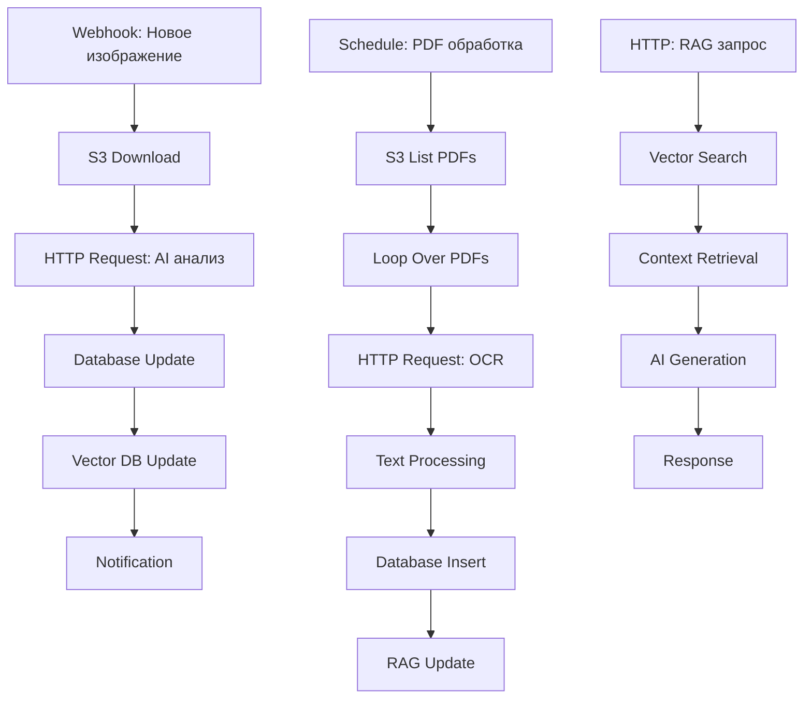

# План выделения сервиса AI/ML для виртуальной галереи искусств

## Обзор проекта

Текущая система виртуальной галереи искусств имеет встроенные AI/ML компоненты с mock-реализациями. Необходимо выделить отдельный AI/ML сервис для:

- Оцифровки и обработки изображений галереи
- Наполнения RAG базы знаний текстовыми данными из PDF файлов с информацией о художественных произведениях
- Интеграции с сайтом галереи и AI-агентом

Сервис должен использовать n8n для автоматизации рабочих процессов, хранить данные в S3 и PostgreSQL на хостинге beget.com.

## Текущая архитектура

### Существующие AI/ML компоненты
- `src/ai-ml/models/artworkAnalyzer.ts` - анализ изображений (mock)
- `src/ai-ml/services/descriptionService.ts` - генерация описаний
- `src/ai-ml/services/RecommendationService.ts` - рекомендации
- Интеграция с S3 для хранения изображений
- PostgreSQL база данных с таблицами для произведений искусства

### Проблемы текущей реализации
- AI/ML логика смешана с основным приложением
- Mock-реализации вместо реальных моделей
- Отсутствие RAG базы знаний
- Нет обработки PDF документов
- Отсутствие отдельного сервиса для масштабирования

## Целевая архитектура

### Микросервисная архитектура

#### Отдельный AI/ML сервис (новый репозиторий на GitHub)
```
ai-ml-service/
├── Python Backend (FastAPI)
│   ├── Image Processing Module
│   ├── PDF Processing Module
│   ├── RAG Knowledge Base
│   └── Vector Database Integration
├── Node.js API Gateway
│   ├── REST API для коммуникации
│   ├── WebSocket для реального времени
│   └── Authentication & Authorization
├── Database Layer
│   ├── PostgreSQL + pgvector/Qdrant
│   ├── Data synchronization
│   └── Schema migrations
├── n8n Integration
│   ├── Workflow definitions
│   ├── Custom nodes
│   └── Automation scripts
└── Deployment
    ├── Docker containers
    ├── Kubernetes manifests
    └── CI/CD pipelines
```

#### Интеграция с основной системой
- **API-first подход**: Все взаимодействие через REST API
- **Асинхронная обработка**: Очереди для фоновых задач
- **Data synchronization**: Синхронизация данных между сервисами
- **Event-driven architecture**: Webhooks и events для уведомлений

##### Стратегия разделения:
1. **Выделить AI/ML код** в отдельный репозиторий
2. **Создать shared libraries** для общих типов и интерфейсов
3. **Настроить data contracts** между сервисами
4. **Реализовать graceful degradation** для отказоустойчивости
5. **Оптимизировать основной сервис** после извлечения AI/ML компонентов

## Детальный план реализации

### Фаза 1: Проектирование архитектуры

#### 1.1 Анализ требований и оценка внешних сервисов
- Определить объем данных для обработки
- Оценить вычислительные ресурсы
- **Оценка внешних AI сервисов для оптимизации разработки**

##### Сервисы компьютерного зрения:
- **Google Cloud Vision API**: OCR, object detection, image analysis
- **AWS Rekognition**: Image recognition, facial analysis, text detection
- **Azure Computer Vision**: OCR, image analysis, spatial analysis
- **Clarifai**: Custom model training, image recognition
- **OpenAI GPT-4 Vision**: Multimodal analysis with GPT-4

##### Сервисы для RAG и NLP:
- **OpenAI API**: GPT models для generation, embeddings для retrieval
- **Anthropic Claude**: Advanced language models
- **Cohere**: Embeddings и generation models
- **Pinecone/Qdrant/Weaviate**: Managed vector databases
- **LangChain/LlamaIndex**: RAG frameworks с интеграцией внешних API

##### Преимущества использования внешних сервисов:
- Быстрая разработка без обучения моделей с нуля
- Высокая точность предобученных моделей
- Масштабируемость и надежность
- Снижение затрат на инфраструктуру

##### Trade-offs:
- Зависимость от внешних провайдеров
- Стоимость API вызовов
- Ограничения на кастомизацию
- Latency и bandwidth considerations

#### 1.2 Проектирование API
- RESTful API для взаимодействия с основным приложением
- WebSocket для реального времени обновлений
- GraphQL для сложных запросов к RAG

#### 1.3 Проектирование базы данных
- Схема для векторных представлений
- Таблицы для метаданных PDF
- Индексы для быстрого поиска

### Фаза 2: Разработка ядра сервиса

#### 2.1 Настройка инфраструктуры отдельного сервиса

##### Создание GitHub репозитория:
- **Структура репозитория**: Monorepo с Python и Node.js компонентами
- **Branching strategy**: GitFlow для управления релизами
- **Access control**: Настройка прав доступа для команды
- **Documentation**: README, API docs, deployment guides

##### Data synchronization между сервисами:
- **Database sharing**: Общая PostgreSQL база с разделенными схемами
- **API contracts**: OpenAPI спецификации для всех endpoints
- **Event streaming**: Apache Kafka или Redis pub/sub для событий
- **Data migration**: Scripts для синхронизации данных при разделении

##### Оптимизация основного приложения:
- **Code cleanup**: Удаление AI/ML зависимостей
- **Performance improvement**: Уменьшение bundle size и memory usage
- **Simplified deployment**: Более легкий и стабильный деплой
- **Independent scaling**: Возможность масштабирования сервисов отдельно

#### 2.2 Реализация обработки изображений
- Интеграция с компьютерным зрением (OpenCV, TensorFlow)
- Генерация векторных представлений изображений
- Классификация стилей и жанров

#### 2.3 Реализация обработки PDF
- OCR для оцифровки текста
- Извлечение метаданных о произведениях искусства
- Парсинг структурированной информации

#### 2.4 Создание RAG системы

##### Методы RAG разработки:

###### Naive RAG:
- Простой retrieval-augmented generation
- Базовый поиск по векторному сходству
- Прямолинейная генерация ответов

###### Advanced RAG:
- **Query Rewriting**: Переформулировка запросов для лучшего поиска
- **Multi-hop Reasoning**: Многошаговый поиск с использованием промежуточных результатов
- **Iterative Retrieval**: Итеративное уточнение поиска

###### Modular RAG:
- **Routing**: Автоматический выбор подходящей стратегии поиска
- **Fusion**: Комбинация результатов из разных источников
- **Memory**: Использование истории взаимодействий

##### Модели и техники:

###### Embedding модели:
- **OpenAI text-embedding-ada-002**: Высококачественные embeddings
- **Sentence Transformers**: Локальные модели для приватности
- **Cohere embed**: Специализированные embeddings для RAG

###### Generation модели:
- **GPT-4/GPT-3.5-turbo**: Для высококачественной генерации
- **Claude**: Для безопасной и точной генерации
- **Llama 2/3**: Open-source альтернативы

###### Retrieval техники:
- **Dense Retrieval**: Векторный поиск по embeddings
- **Sparse Retrieval**: TF-IDF, BM25 для ключевых слов
- **Hybrid Retrieval**: Комбинация dense и sparse методов
- **Re-ranking**: Переранжировка результатов для лучшей релевантности

##### Программная реализация RAG системы:

###### Python реализация с LangChain:
```python
from langchain.vectorstores import Qdrant
from langchain.embeddings import OpenAIEmbeddings
from langchain.llms import OpenAI
from langchain.chains import RetrievalQA
from langchain.text_splitter import RecursiveCharacterTextSplitter

# Инициализация компонентов
embeddings = OpenAIEmbeddings(model="text-embedding-ada-002")
vectorstore = Qdrant(
    client=client,
    collection_name="artwork_knowledge",
    embeddings=embeddings
)

# Text splitter для chunking
text_splitter = RecursiveCharacterTextSplitter(
    chunk_size=1000,
    chunk_overlap=200,
    length_function=len
)

# Создание RAG chain
qa_chain = RetrievalQA.from_chain_type(
    llm=OpenAI(model="gpt-4", temperature=0.1),
    chain_type="stuff",
    retriever=vectorstore.as_retriever(search_kwargs={"k": 5}),
    return_source_documents=True
)

# Обработка запроса
def process_rag_query(query: str) -> dict:
    result = qa_chain({"query": query})

    return {
        "answer": result["result"],
        "sources": [
            {
                "content": doc.page_content,
                "metadata": doc.metadata,
                "score": doc.score if hasattr(doc, 'score') else None
            }
            for doc in result["source_documents"]
        ]
    }
```

###### Advanced RAG с query expansion:
```python
from langchain.chains import LLMChain
from langchain.prompts import PromptTemplate

# Query expansion chain
expansion_prompt = PromptTemplate(
    input_variables=["query"],
    template="""
    Generate 3 different versions of this question to improve retrieval:
    Original: {query}

    Variations:
    1.
    2.
    3.
    """
)

expansion_chain = LLMChain(llm=OpenAI(temperature=0.7), prompt=expansion_prompt)

# Multi-query retrieval
def multi_query_retrieval(query: str, vectorstore, top_k: int = 5):
    # Generate query variations
    variations = expansion_chain.run(query=query).split('\n')

    all_docs = []
    for var in variations:
        if var.strip():
            docs = vectorstore.similarity_search(var.strip(), k=top_k//len(variations))
            all_docs.extend(docs)

    # Remove duplicates and rerank
    unique_docs = list(set(all_docs))
    return unique_docs[:top_k]
```

##### Инфраструктурная реализация:

###### Docker Compose для локальной разработки:
```yaml
version: '3.8'
services:
  qdrant:
    image: qdrant/qdrant:v1.7.4
    ports:
      - "6333:6333"
      - "6334:6334"
    volumes:
      - ./qdrant_storage:/qdrant/storage

  ai-ml-service:
    build: .
    ports:
      - "8000:8000"
    environment:
      - QDRANT_URL=http://qdrant:6333
      - OPENAI_API_KEY=${OPENAI_API_KEY}
    depends_on:
      - qdrant

  n8n:
    image: n8nio/n8n
    ports:
      - "5678:5678"
    environment:
      - N8N_ENCRYPTION_KEY=${N8N_ENCRYPTION_KEY}
    volumes:
      - ~/.n8n:/home/node/.n8n
```

###### Kubernetes deployment для продакшена:
```yaml
apiVersion: apps/v1
kind: Deployment
metadata:
  name: qdrant
spec:
  replicas: 1
  selector:
    matchLabels:
      app: qdrant
  template:
    metadata:
      labels:
        app: qdrant
    spec:
      containers:
      - name: qdrant
        image: qdrant/qdrant:v1.7.4
        ports:
        - containerPort: 6333
        - containerPort: 6334
        volumeMounts:
        - name: qdrant-storage
          mountPath: /qdrant/storage
      volumes:
      - name: qdrant-storage
        persistentVolumeClaim:
          claimName: qdrant-pvc

---
apiVersion: v1
kind: Service
metadata:
  name: qdrant-service
spec:
  selector:
    app: qdrant
  ports:
  - port: 6333
    targetPort: 6333
  - port: 6334
    targetPort: 6334
```

##### Архитектура RAG системы:
```
User Query
    ↓
Query Processing (rewriting, expansion)
    ↓
Multi-vector Retrieval (Qdrant + PostgreSQL)
    ↓
Context Selection & Ranking (Reranking model)
    ↓
Prompt Engineering (Few-shot examples)
    ↓
Generation Model (GPT-4/Claude)
    ↓
Response Post-processing (Fact-checking, formatting)
```

##### Оптимизации:
- **Chunking стратегии**: Разделение текста на оптимальные фрагменты
- **Metadata filtering**: Фильтрация по метаданным для точности
- **Query expansion**: Расширение запросов синонимами
- **Caching**: Кэширование частых запросов

### Фаза 3: Интеграция с n8n

#### 3.1 Проектирование рабочих процессов
- Автоматическая обработка новых изображений
- Пакетная обработка PDF документов
- Обновление RAG базы при добавлении контента

#### 3.2 Детальное описание n8n workflows

##### Workflow 1: Обработка новых изображений
1. **Webhook Trigger** - получение уведомления о новом изображении из основного приложения
2. **S3 Download** - скачивание изображения из S3
3. **HTTP Request** - вызов AI/ML сервиса для анализа изображения
4. **Database Update** - сохранение результатов анализа в PostgreSQL
5. **Vector DB Update** - обновление векторных представлений в Qdrant/PostgreSQL
6. **Notification** - отправка уведомления об окончании обработки

##### Workflow 2: Пакетная обработка PDF
1. **Schedule Trigger** - регулярный запуск для обработки накопившихся PDF
2. **S3 List** - получение списка новых PDF файлов
3. **Loop Over Items** - обработка каждого PDF
4. **HTTP Request** - вызов сервиса OCR и извлечения текста
5. **Text Processing** - парсинг и структурирование данных
6. **Database Insert** - сохранение метаданных в PostgreSQL
7. **RAG Update** - добавление текста в knowledge base

##### Workflow 3: Запросы к RAG системе
1. **HTTP Request Trigger** - получение запроса от AI-агента
2. **Vector Search** - поиск релевантных векторов
3. **Context Retrieval** - извлечение контекста из базы знаний
4. **AI Generation** - генерация ответа с использованием LLM
5. **Response** - возврат результата

### Диаграмма n8n workflows



#### 3.3 Детальная настройка n8n

##### Установка и базовая конфигурация:
```bash
# Docker запуск n8n
docker run -it --rm \
  --name n8n \
  -p 5678:5678 \
  -v ~/.n8n:/home/node/.n8n \
  n8nio/n8n

# Переменные окружения
export N8N_ENCRYPTION_KEY="your-encryption-key"
export N8N_BASIC_AUTH_ACTIVE=true
export N8N_BASIC_AUTH_USER="admin"
export N8N_BASIC_AUTH_PASSWORD="password"
```

##### Ключевые интеграции:

###### HTTP Request Node для AI/ML API:
```json
{
  "method": "POST",
  "url": "http://ai-ml-service:8000/api/v1/analyze-image",
  "body": {
    "image_url": "{{ $node[\"S3 Download\"].json.image_url }}",
    "artwork_id": "{{ $node[\"Webhook\"].json.artwork_id }}"
  },
  "headers": {
    "Authorization": "Bearer {{ $credentials.apiToken }}",
    "Content-Type": "application/json"
  }
}
```

###### PostgreSQL Database Node:
```json
{
  "operation": "insert",
  "table": "artwork_analysis",
  "columns": [
    "artwork_id",
    "style",
    "dominant_colors",
    "tags",
    "confidence"
  ],
  "values": [
    "{{ $node[\"HTTP Request\"].json.artwork_id }}",
    "{{ $node[\"HTTP Request\"].json.analysis.style }}",
    "{{ $node[\"HTTP Request\"].json.analysis.colors }}",
    "{{ $node[\"HTTP Request\"].json.analysis.tags }}",
    "{{ $node[\"HTTP Request\"].json.analysis.confidence }}"
  ]
}
```

###### S3 Node для загрузки:
```json
{
  "operation": "upload",
  "bucketName": "art-gallery-bucket",
  "fileName": "{{ $node[\"Webhook\"].json.filename }}",
  "fileContent": "{{ $node[\"Webhook\"].binary.data }}",
  "region": "us-east-1"
}
```

##### Custom Qdrant Node (программная реализация):
```javascript
// custom-qdrant-node/index.js
const { QdrantClient } = require('@qdrant/js-rest-client');

class QdrantNode {
  async execute() {
    const client = new QdrantClient({
      url: this.getNodeParameter('qdrantUrl'),
      apiKey: this.getNodeParameter('apiKey')
    });

    const operation = this.getNodeParameter('operation');

    if (operation === 'upsert') {
      return await client.upsert(this.getNodeParameter('collection'), {
        points: this.getNodeParameter('points')
      });
    }

    if (operation === 'search') {
      return await client.search(this.getNodeParameter('collection'), {
        vector: this.getNodeParameter('queryVector'),
        limit: this.getNodeParameter('limit') || 10
      });
    }
  }
}

module.exports = QdrantNode;
```

##### Workflow triggers и scheduling:
- **Webhook Trigger**: Для обработки новых изображений
- **Schedule Trigger**: Для регулярной обработки PDF (`0 */4 * * *` - каждые 4 часа)
- **Manual Trigger**: Для ручного запуска процессов
- **Error Trigger**: Для обработки ошибок и повторных попыток

##### Мониторинг и логирование:
- **Execution Logs**: Встроенное логирование n8n
- **External Logging**: Интеграция с ELK stack
- **Metrics**: Prometheus metrics для мониторинга
- **Alerts**: Slack/webhook уведомления об ошибках

### Фаза 4: Интеграция с основной системой

#### 4.1 Модификация основного приложения
- Замена mock-реализаций на вызовы API нового сервиса
- Обновление контроллеров для асинхронной обработки
- Добавление очередей для фоновых задач

#### 4.2 Обновление базы данных
- Миграции для новых таблиц RAG
- Добавление полей для векторных представлений
- Оптимизация индексов

### Фаза 5: Тестирование и развертывание

#### 5.1 Тестирование
- Unit тесты для отдельных компонентов
- Integration тесты для API
- End-to-end тесты для рабочих процессов

#### 5.2 Развертывание
- Настройка на beget.com хостинге
- Конфигурация S3 бакетов
- Мониторинг и логирование

## Технологический стек

### AI/ML фреймворки
- **Гибридный подход**: Python для AI/ML обработки + Node.js для API слоя
- Python с FastAPI для core AI/ML сервиса (лучше для TensorFlow/PyTorch интеграции)
- Node.js с Express для API gateway и интеграции с основным приложением
- PyTorch/TensorFlow для моделей компьютерного зрения
- Hugging Face Transformers для NLP задач и RAG
- OpenCV для предварительной обработки изображений

### Обоснование выбора технологий
- **Python**: Лучшая экосистема для AI/ML, богатство библиотек, проще интеграция с моделями
- **Node.js**: Сохранение консистентности с основным приложением, легче интеграция
- **Гибрид**: AI/ML сервис на Python обрабатывает тяжелые вычисления, Node.js API обеспечивает коммуникацию

### Базы данных и хранилище

#### Qdrant - детальная реализация:

##### Установка и настройка:
```bash
# Docker установка
docker run -p 6333:6333 -p 6334:6334 \
    -v $(pwd)/qdrant_storage:/qdrant/storage \
    qdrant/qdrant

# Python клиент
pip install qdrant-client

# Node.js клиент
npm install @qdrant/js-rest-client
```

##### Конфигурация Qdrant:
```yaml
# config.yaml
log_level: INFO
storage:
  storage_path: ./qdrant_storage
  snapshots_path: ./qdrant_snapshots
  temp_path: ./qdrant_temp
  wal_path: ./qdrant_wal
service:
  http_port: 6333
  grpc_port: 6334
  max_request_size_mb: 32
  max_workers: 4
```

##### Создание коллекций:
```python
from qdrant_client import QdrantClient
from qdrant_client.models import Distance, VectorParams

client = QdrantClient("localhost", port=6333)

# Создание коллекции для изображений
client.create_collection(
    collection_name="artwork_embeddings",
    vectors_config=VectorParams(size=512, distance=Distance.COSINE),
    optimizers_config=OptimizersConfigDiff(
        indexing_threshold=10000,
        memmap_threshold=50000
    )
)

# Создание коллекции для текста
client.create_collection(
    collection_name="text_embeddings",
    vectors_config=VectorParams(size=1536, distance=Distance.COSINE)
)
```

##### Операции с векторами:
```python
# Добавление векторов
client.upsert(
    collection_name="artwork_embeddings",
    points=[
        {
            "id": artwork_id,
            "vector": embedding_vector,
            "payload": {
                "title": artwork.title,
                "artist": artwork.artist,
                "style": artwork.style,
                "tags": artwork.tags
            }
        }
    ]
)

# Поиск похожих
search_results = client.search(
    collection_name="artwork_embeddings",
    query_vector=query_embedding,
    limit=10,
    score_threshold=0.7,
    with_payload=True
)
```

- S3 для хранения файлов
- Redis для кэширования

### Инструменты автоматизации
- n8n для рабочих процессов
- Docker для контейнеризации
- Kubernetes для оркестрации (опционально)

## Риски и mitigation

### Технические риски
- Высокие требования к вычислительным ресурсам
- Сложность интеграции с существующими mock-реализациями
- Потенциальные проблемы с производительностью

### Бизнес-риски
- Длительное время разработки
- Необходимость обучения команды новым технологиям
- Зависимость от внешних AI сервисов

## Метрики успеха

- Время обработки одного изображения: < 30 секунд
- Точность распознавания стилей: > 85%
- Время отклика RAG запросов: < 500ms
- Uptime сервиса: > 99.5%

## Следующие шаги

1. Создать детальную спецификацию API
2. Начать разработку прототипа обработки изображений
3. Настроить тестовую среду с n8n
4. Провести POC для RAG системы


Создали базу данных Postgresql ai-ml-service
📊 Созданные таблицы:

       * ✅ ai_tasks - отслеживание AI задач
       * ✅ webhooks - webhook конфигурации
       * ✅ artwork_analysis - анализ изображений
       * ✅ pdf_documents - метаданные PDF
       * ✅ pdf_chunks - фрагменты для RAG (с TEXT для векторов)
       * ✅ embeddings - векторные представления (с TEXT для векторов)
       * ✅ rag_queries - запросы RAG (с TEXT для векторов)
       * ✅ api_usage - статистика использования
       * ✅ model_performance - метрики моделей