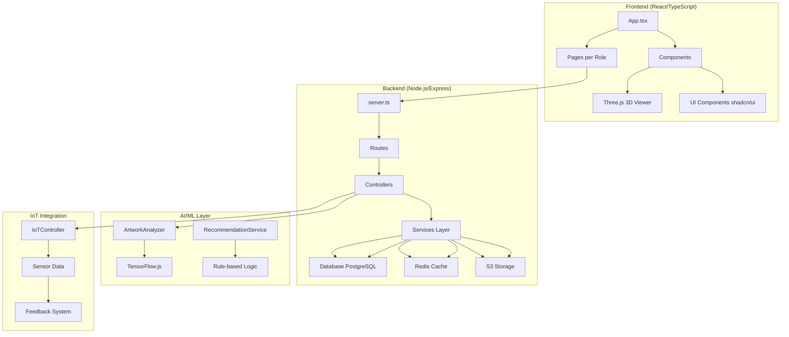
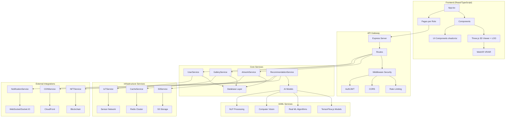
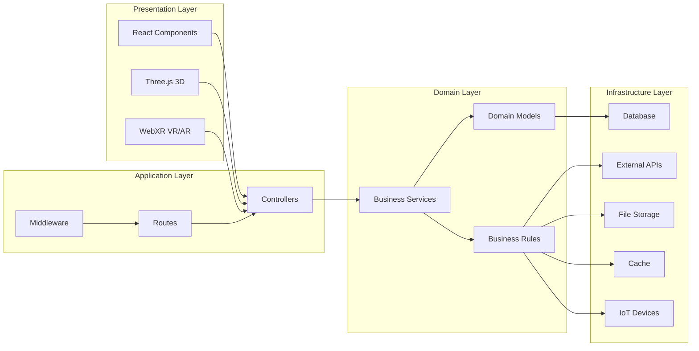
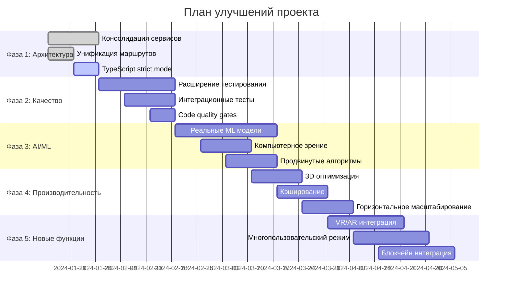

# Архитектурные диаграммы

## Текущая архитектура



## Предлагаемая архитектура после улучшений



## Архитектурные слои



## План миграции



## Компоненты для рефакторинга

```mermaid
stateDiagram-v2
    [*] --> CurrentArchitecture
    CurrentArchitecture --> ConsolidationPhase: Фаза 1
    ConsolidationPhase --> QualityPhase: Фаза 2
    QualityPhase --> AIMLPhase: Фаза 3
    AIMLPhase --> PerformancePhase: Фаза 4
    PerformancePhase --> FeaturesPhase: Фаза 5
    FeaturesPhase --> [*]

    state CurrentArchitecture as "Текущая архитектура
    - Дублирование сервисов
    - Смешанная типизация
    - Rule-based AI
    - Недостаточное тестирование"

    state ConsolidationPhase as "Фаза 1: Консолидация
    - Унификация сервисов
    - Удаление дубликатов
    - Строгая типизация"

    state QualityPhase as "Фаза 2: Качество
    - 80%+ test coverage
    - ESLint без ошибок
    - Интеграционные тесты"

    state AIMLPhase as "Фаза 3: AI/ML
    - TensorFlow.js модели
    - Computer vision
    - Продвинутые алгоритмы"

    state PerformancePhase as "Фаза 4: Производительность
    - 3D LOD optimization
    - Redis caching
    - CDN integration"

    state FeaturesPhase as "Фаза 5: Новые функции
    - VR/AR полная поддержка
    - Multi-user режим
    - NFT и блокчейн"